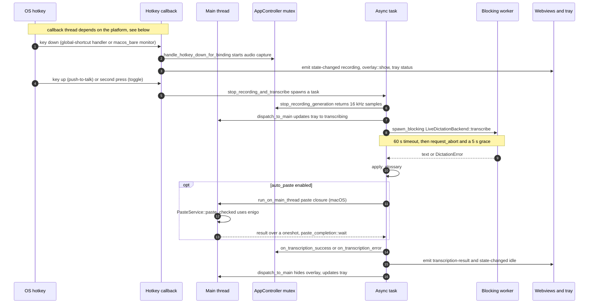
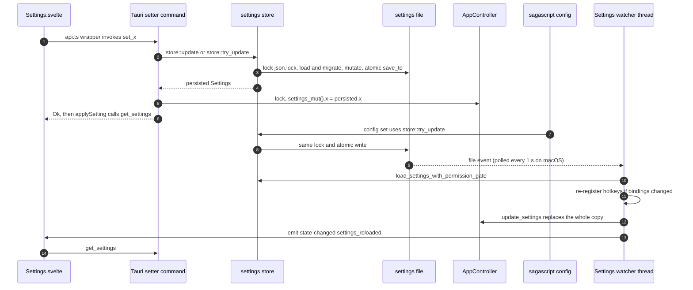
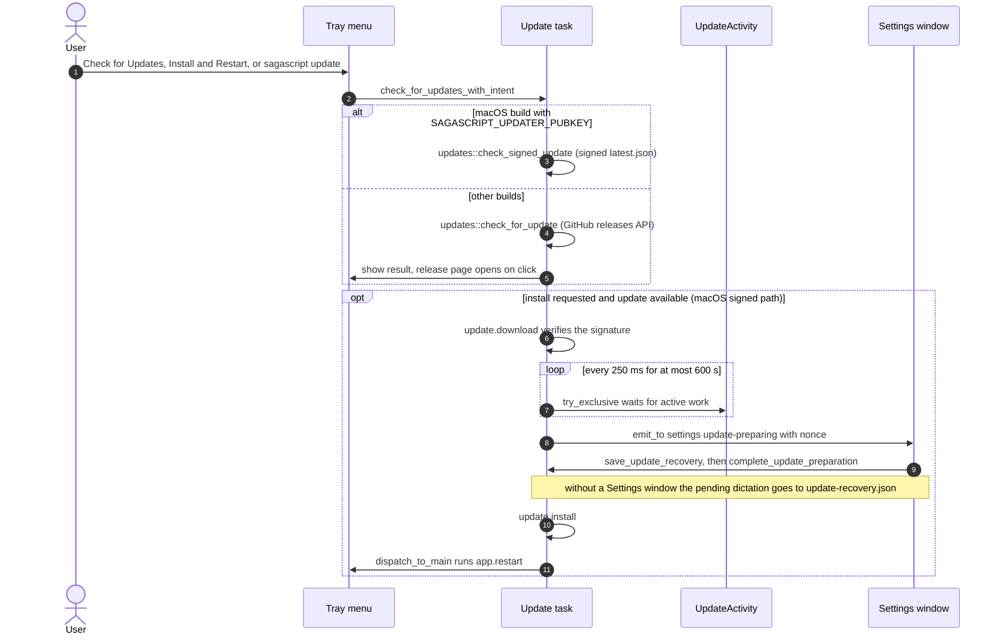
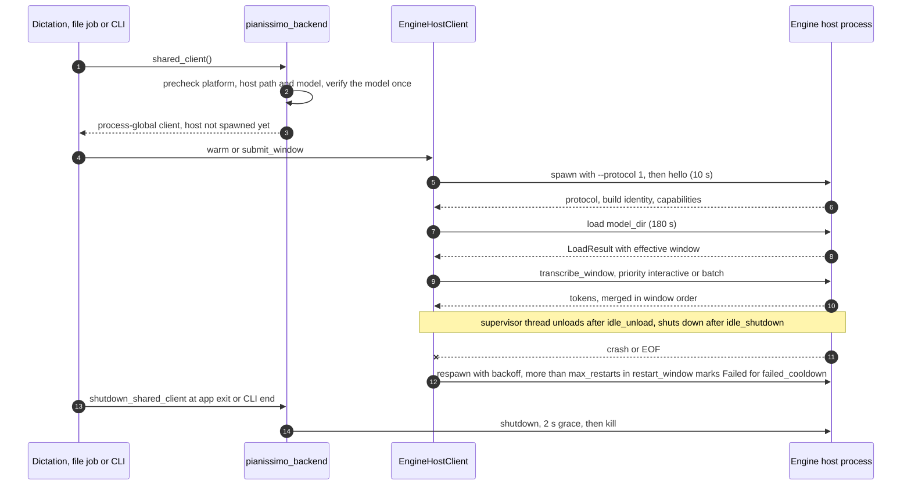

# Sagascript architecture

A map for agents and humans: what lives where, how the four main flows move through the
code, which threads and locks are involved, which feature flags exist, and where tests run.
It describes the code as it is; lines starting with **Planned:** link the issue that will
change a mechanism. Read [AGENTS.md](../AGENTS.md) first for the invariants and the
verification commands, [docs/recipes/](recipes/README.md) for step-by-step changes and
[docs/adr/](adr/README.md) for the reasons behind the rules.

## 1. Repository map

| Path | Responsibility |
|---|---|
| `src/` | Svelte 5 frontend (runes). `App.svelte` picks the view from the URL: `?overlay`, `?onboarding`, otherwise Settings. |
| `src/lib/api.ts`, `src/lib/meeting-reprocessing-api.ts` | The only `invoke` wrappers, plus hand-written TypeScript copies of Rust DTOs (`Settings`, `HotkeyProfile`, …). |
| `src/lib/*.svelte` | `Settings.svelte` (Dictate / Transcribe / Settings tabs), `Onboarding.svelte`, `Overlay.svelte`, `FileTranscription.svelte`, `Meeting*.svelte`, `TranscriptionStages.svelte`. |
| `src/lib/*.ts`, `src/lib/*.js` | DOM-free logic (reducers, queues, update recovery) tested by `scripts/test-*.mjs`. |
| `src-tauri/src/` | App crate `sagascript`: CLI dispatch, Tauri shell, tray, hotkeys, paste, overlay, updater, Tauri commands. |
| `src-tauri/crates/sagascript-core/` | Library: audio decode/resample/capture, Whisper and Pianissimo transcription, engine-host client, settings store, model downloads, diarization, meeting documents. |
| `src-tauri/crates/sagascript-cli/` | Library + headless `sagascript` binary: every clap subcommand. Also holds meeting/diarization pipelines that the app imports. |
| `src-tauri/crates/sagascript-engine-protocol/` | Wire types for the engine-host JSON Lines protocol ([spec](engine-host-protocol.md)); used by the core client, the ORT host and the fake host. |
| `src-tauri/crates/sagascript-testsupport/` | Dev-only test helpers shared by core, CLI and app tests: `TempDir` (unique, removed on drop), `fake_settings` (a settings file alone in its own `TempDir`), `sha256_hex`, `isolated_cli_env` (spawned CLI without inherited credentials, with `SAGASCRIPT_SETTINGS_PATH`). Never linked into a shipped binary. |
| `src-tauri/engine-host/coreml/` | Swift package: Core ML host `sagascript-engine-host` (Pianissimo on macOS 14+ Apple silicon). |
| `src-tauri/engine-host/ort/` | Standalone Cargo workspace (own `Cargo.lock`): ONNX Runtime CPU host `sagascript-engine-host-ort`, shipped for Windows on ARM. |
| `src-tauri/engine-host/test-vectors/` | `context-biasing.json`, loaded by both hosts' unit tests. |
| `src-tauri/tauri.conf.json`, `src-tauri/capabilities/` | App config (`frontendDist: ../dist`) and plugin permissions. |
| Meeting modules | Core `meeting.rs`, `meeting_media.rs`, `meeting_review.rs`, `meeting_reprocess*.rs`; CLI `meeting.rs`, `meeting_proposal.rs`, `meeting_reprocessing*.rs` and the meeting part of `transcribe.rs`; app `meeting_jobs.rs`, `meeting_media*.rs`, `meeting_review_commands.rs`, `meeting_reprocessing_commands.rs`. Docs: `docs/meeting-*.md`. |
| `scripts/` | Build/release/CI helpers (`*.sh`, `*.mjs`, `*.ps1`), Node tests `test-*.mjs`, Playwright suites `qa-*.mjs`, browser IPC mock `fixtures/transcription-browser-mock.js`, Python tooling `dictation_eval/` and `diarization_sv/`, Core ML conversion `pianissimo-coreml/`. |
| `tests/` | Code-health contract tests (`tests/scripts/`) and fixtures (`tests/fixtures/code-health/`). |
| `tooling/code-health/` | Pinned `knip`/TypeScript used by `.github/workflows/code-health.yml`. |
| `site/` | Separate marketing site (React, vinext, Cloudflare `wrangler`); no workflow builds or lints it. |
| `test-audio/` | Small audio fixtures for smoke tests and benchmarks. |

App crate modules (`src-tauri/src/`):

| Module | Role |
|---|---|
| `main.rs` | `main()`: CLI dispatch, Tauri builder and `.setup`, tray and update menu, signed updater, live dictation pipeline, settings watcher, window handling. |
| `commands.rs` | Most `#[tauri::command]`s, `SharedController` / `SharedWhisper`, Dictate test recording, file transcription, permissions. |
| `app_controller.rs` | `AppController`: dictation state (`AppState`), audio capture, in-memory `Settings` copy, session logging. |
| `events.rs` | Event-name constants (`events::event::*`). |
| `hotkey/` | Shortcut registration, `HotkeyHealth`, bare F-key monitor `macos_bare.rs`. |
| `paste/` | `PasteService` (clipboard + simulated paste: enigo on macOS/Windows, `xdotool` on Linux). `paste/completion.rs` (completion wait) is mounted from `main.rs` via `#[path]` as `crate::paste_completion`. |
| `platform/`, `overlay.rs`, `focus_diag.rs`, `logging/` | Per-OS helpers, recording indicator window, focus diagnostics, app log file. |
| `plain_file_jobs.rs`, `meeting_*.rs` | File-transcription and meeting job slots, cancel, deadlines. |
| `updates.rs`, `update_activity.rs`, `update_recovery.rs` | Update checks, work/exclusivity accounting, recovery drafts. |

**Dependency direction:** `sagascript-engine-protocol` ← `sagascript-core` ← `sagascript-cli`
← app. The app uses the CLI crate for CLI dispatch (`sagascript_cli::try_parse`,
`sagascript_cli::run`) and for meeting pipelines (`sagascript_cli::transcribe`,
`sagascript_cli::meeting_reprocessing`, `sagascript_cli::meeting_proposal`).
**Planned:** [#374](https://github.com/Magnus-Gille/sagascript/issues/374) moves those
pipelines into core.

`sagascript-testsupport` is only a dev-dependency (of core, the CLI and the app) and depends
on none of them; fixtures made of core types (`meeting_transcript()`) live in
`sagascript_core::test_support` behind `cfg(test)` or core's `test-support` feature, which
the CLI and the app enable as a dev-dependency.

**Binaries:** the app crate and the CLI crate both build `sagascript`; a bare app invocation
starts the GUI, a subcommand runs the CLI and exits. The headless CLI prints help and exits 2
without a subcommand. `target/<profile>/sagascript` is whichever was built last. Core also
builds `sagascript-fake-engine-host` (`crates/sagascript-core/tests/support/fake_engine_host.rs`)
for tests.

**Build facts that bite:**

- Bare `cargo build/test/clippy` in `src-tauri/` covers only the app (`default-members = ["."]`);
  use `--workspace` or `-p`.
- `tauri::generate_context!()` needs `../dist`. Run `npm run build` before any cargo command
  that compiles the app crate (check, test, clippy), or it fails at compile time;
  `npm run verify` reports a missing `dist/` before running those checks.
- `swift test` needs `Sources/EngineHostCore/BuildInfo.swift`, which is gitignored and written
  by `scripts/build-engine-host.sh` (CI runs `scripts/stage-engine-host.sh` first;
  `npm run verify -- --only swift` runs it before `swift test`).
- `rust-toolchain.toml` pins the development compiler; `rust-version` in `src-tauri/Cargo.toml`
  is the minimum supported version (MSRV), checked by CI's `msrv-linux` job.
- Build identity comes from `src-tauri/build.rs` (`GIT_HASH`, `BUILD_DATE`, overridable with
  `SAGASCRIPT_GIT_HASH` / `SAGASCRIPT_BUILD_DATE`) and feeds the tray `BUILD_IDENTITY`, the
  `get_build_info` command and the engine-host handshake.

## 2. Data flows

### 2.1 Dictation: hotkey → record → transcribe → paste

- Code: `handle_hotkey_event`, `handle_hotkey_release`, `stop_recording_and_transcribe` and
  `restore_target_before_paste` in `src-tauri/src/main.rs`; capture in `AppController`
  (`app_controller.rs`) over `sagascript_core::audio::AudioCaptureService`; engine choice in
  `crates/sagascript-core/src/transcription/live_dictation.rs` (Whisper via
  `whisper_backend.rs`, Pianissimo via `pianissimo_backend.rs` and the engine host, 2.4).
- Callback thread: `tauri-plugin-global-shortcut` calls `handle_hotkey_event` inline from
  `global-hotkey`. On macOS that is the main thread (Carbon handler; the `macos_bare` NSEvent
  monitors too); on Windows key-down arrives on the main thread and key-up on a spawned
  `GetAsyncKeyState` polling thread; on Linux (X11) both arrive on the library's event thread,
  so the direct `overlay::show`, `select_profile_menu` and `update_tray_status` calls there
  break [ADR 0003](adr/0003-main-thread-native-apis.md) (known violation).
- Main-thread hops: the handler must not block (the 300 ms `MIN_RECORDING_MS` top-up is a
  `tokio::time::sleep` inside the task); tray and overlay updates from the task go through
  `dispatch_to_main`; on macOS `restore_target_before_paste` waits on the blocking pool and
  sends each AppKit call to the main thread with a 500 ms timeout, then the paste closure runs
  via `run_on_main_thread`. On Windows and Linux the paste closure runs on `spawn_blocking`.
- The Dictate tab's test recording (`commands::stop_and_transcribe`) repeats the
  timeout/abort transaction with its own `TRANSCRIPTION_TIMEOUT_SECS` / `ABORT_GRACE_SECS`.
  **Planned:** [#344](https://github.com/Magnus-Gille/sagascript/issues/344) makes the
  lifecycle testable outside Tauri.

### 2.2 Settings layers: disk ↔ store ↔ AppController ↔ watcher ↔ frontend

| Layer | Where | Notes |
|---|---|---|
| Disk | `${XDG_CONFIG_HOME:-~/.config}/sagascript/sagascript-settings.json`, `glossary.txt`, `glossaries/*.txt` | See [configuration.md](configuration.md). `SAGASCRIPT_SETTINGS_PATH` selects an exact file and disables legacy migration (tests, isolated CLI runs). |
| Model | `Settings` in `crates/sagascript-core/src/settings/manager.rs` | `#[serde(default)]` on the struct: missing keys take `Default` values. |
| Store | `crates/sagascript-core/src/settings/store.rs` | `load`, `load_from`, `save`, `update`, `try_update`; cross-process `fs2` lock on `<file>.json.lock`; read-merge-write keeps unknown keys; atomic rename. |
| AppController | `app_controller.rs` | In-memory copy: `settings()`, `settings_mut()`, `update_settings()`. Dictation reads it at use time. |
| Watcher | `start_settings_watcher` in `main.rs` | `PollWatcher` on macOS, `RecommendedWatcher` elsewhere; filter `configuration_event_may_affect`; waits while a dictation records (`acquire_hotkey_configuration`). Fires for the app's own writes too (harmless reload). |
| Frontend | `getSettings()` / setters in `src/lib/api.ts`; `applySetting()` and the `settings_reloaded` listener in `Settings.svelte` | Always re-reads after a write. |

Rules: write through `store::update`/`try_update` (never `save()` a possibly stale clone);
release the file lock before taking the controller lock; the watcher replays only hotkey
registration, Pianissimo warm/unload and the profiles menu, so side effects that live in a
setter (for example `overlay::on_show_overlay_changed`, the VAD model download in
`set_vad_enabled`) do not run for CLI edits. A value that does not read resets only its field,
with a warning, and a save over such a file first preserves its bytes as `.bak`. Migrations are
the ordered steps in `settings/migrations.rs`, recorded as `schema_version` plus the legacy
markers, and the copy from legacy locations ([ADR 0007](adr/0007-settings-file-evolution.md)).
**Planned:** [#373](https://github.com/Magnus-Gille/sagascript/issues/373) (one implementation
per CLI/app operation).

### 2.3 Updater phases

- Code: `check_for_updates_with_intent`, `install_signed_update`, `prepare_update_recovery`
  in `main.rs`; `updates.rs`; `UpdateActivity` / `UpdatePreparation` in `update_activity.rs`;
  `update_recovery.rs`. Checks are never implicit (test
  `normal_gui_launches_never_check_for_updates_implicitly`). `sagascript update` (macOS)
  opens the app with `GUI_UPDATE_ARG` (`--install-update`), handled by
  `second_instance_requests_update` / `should_install_update_at_launch`.
- A failure in any phase resets the menu to "Try Again…"; failures during preparation or
  install also emit `update-aborted` to Settings. The `updater-smoke-test` feature points the
  manifest at a loopback URL (section 4).
- **Planned:** [#376](https://github.com/Magnus-Gille/sagascript/issues/376) puts the
  orchestration behind traits; [#369](https://github.com/Magnus-Gille/sagascript/issues/369)
  moves it out of `main.rs`.

### 2.4 Engine-host process lifecycle

- Code: `crates/sagascript-core/src/transcription/engine_host/` (`process.rs` transport,
  `client.rs` handshake/lifecycle/restart budget, `pipeline.rs` long-audio windows) and
  `pianissimo_backend.rs` (`resolve_host`, `runtime_supported_on_this_os`, `config_for_host`,
  `shared_client`, `warm_in_background`, `shutdown_shared_client`). The client API is
  blocking; each host has a stdout reader and a stderr drain thread, and a client gets a
  supervisor thread only when an idle policy is set.
- Settings: `engine_idle_unload_minutes` → `idle_policy` (unload after N minutes, exit after
  2N, 0 = never); `engine_prewarm` (`off`, `on_app_start`, `on_key_down`). Hosts are
  resolved from the bundle (`Resources/EngineHost/sagascript-engine-host`,
  `engine-host\sagascript-engine-host-ort.exe`); `SAGASCRIPT_ENGINE_HOST` only in development
  builds (`dev-overrides`).
- Recovery ([#366](https://github.com/Magnus-Gille/sagascript/issues/366)): `Failed` lasts
  `failed_cooldown` (60 s), then one fresh start (half-open); a window that times out returns at
  once, and a detached `engine-host-wedge-watch` thread kills the host if it sends no terminal
  response within `wedge_grace` (30 s) after `cancel`; stdin writes are bounded
  (`Timeouts::write`); the restart backoff is slept unlocked and is cancel-aware.
  `EngineHostClient::reset()` clears `Failed` at once but has no production caller: settings that
  change the engine (host, model, compute units, idle policy) already replace the shared client
  (`shared_client`), model deletion shuts it down, and the CLI `engine doctor` uses its own client.
- PCM temp dirs hold a locked `owner.lock`; `pipeline::sweep_stale_pcm_dirs` (app startup and
  shared-client creation, background, once per process; `engine doctor` on demand) removes the
  dirs of dead owners, and dirs whose owner cannot be proven dead (pre-#366, or on a file system
  that cannot lock) once untouched for 24 h.
- **Planned:** [#367](https://github.com/Magnus-Gille/sagascript/issues/367) (machine-checked
  protocol).

## 3. Threads and locks

| Thread | What runs there |
|---|---|
| Main (UI) thread | Tauri setup, tray/window/overlay APIs, global-shortcut callbacks on macOS (and key-down on Windows), `macos_bare` callbacks, `run_on_main_thread` closures (macOS paste, AppKit focus calls), sync (non-`async`) Tauri commands. |
| Tokio runtime | `async` Tauri commands, tasks from `tauri::async_runtime::spawn` (dictation stop pipeline, update flow). |
| Blocking pool | `spawn_blocking`: inference, paste on Windows/Linux, focus-restore wait, recovery file I/O. |
| Dedicated threads | Settings watcher, startup model warm-up, engine-host reader/stderr/stdin-writer/supervisor/wedge-watch threads and the PCM temp dir sweep, audio capture worker and cpal callback, `global-hotkey` event thread (Linux) and key-up polling thread (Windows). |
| CLI | `sagascript_cli::run` builds its own Tokio runtime; inference commands run on a worker thread (16 MiB stack on Windows, `run_inference_command`). |

| Lock | Where | Notes |
|---|---|---|
| `SharedController = Mutex<AppController>` | `commands.rs`, managed in `main()` | Taken from commands, the hotkey handler, the watcher, the updater and meeting jobs, always via `lock_controller`. Audio start/stop and log writes happen under it. Never hold it across `.await` or inference; `SharedWhisper` lives outside it for that reason. |
| `<settings>.json.lock` | `with_settings_lock` in `settings/store.rs` | Exclusive file lock shared by app and CLI processes, held for read-merge-write only. |
| `HotkeyHealth { state, transition }` | `hotkey/health.rs` | `transition` serializes OS (un)registration between commands and the watcher; kept out of the controller on purpose (see its doc comment). |
| `UpdateActivity`, `UpdatePreparation` | `update_activity.rs` | Work leases and the exclusive update permit. |
| Tray state (`SharedUpdateMenuState`, `SharedStatusItem`, `SharedProfileMenuState`) | `main.rs` | Short critical sections. |
| Job slots (`MeetingJobs`, `SharedMeetingAudio`, `PlainFileJobs` fields) | `meeting_jobs.rs`, `meeting_media.rs`, `plain_file_jobs.rs` | One active job each. |
| `LoggingService` (`log_file`, `dictation_session_id`) | `logging/service.rs` | Taken inside controller methods. |
| `WhisperBackend` (`load_lock`, `state`, `context`, `loaded_runtime`, `cached_runtime`) | `transcription/whisper_backend.rs` | `load_lock` and `state` are taken with a bounded wait (`lock_load_bounded`, `lock_state_bounded`, `WARM_STATE_GRACE`), returning `ModelBusy` instead of blocking. |
| Engine host (`lifecycle`, `state`, `boost`; process `routing`, `stdin`, `child`) | `engine_host/client.rs`, `process.rs` | `lifecycle` serializes start/load/unload/shutdown; it is released while a restart backoff is slept. `stdin` only guards the writer thread's queue, never a write. |
| Pianissimo `shared_slot` and load-state statics | `pianissimo_backend.rs` | Process-global client. |
| Others | `AudioCaptureService` buffers (`audio/capture.rs`), `GLOBAL_DICTATION` (`logging/service.rs`), the download `verification_cache` (`download.rs`), `LiveDictationBackend.active_job`, `PianissimoBackend.active`, `HostProcess` `stderr_tail`/`reader`, the CLI `Canceller` (`cancel.rs`) | Leaf locks. The capture buffers are taken under `SharedController` by start/stop and without it by the capture worker and cpal callback. |

Observed acquisition order (outer → inner). Nothing enforces it; keep new code consistent:

1. `HotkeyHealth.transition` is held for a whole hotkey transaction (`apply_hotkey_change`,
   settings watcher). Inside it the controller lock and the settings file lock are each taken
   and released in turn, never nested. The configuration lease (`acquire_hotkey_configuration`)
   is a flag, not a lock: `apply_hotkey_change` takes `transition` then the lease, the watcher
   the lease then `transition`. No deadlock (the lease is try-acquire), but a GUI hotkey change
   that races a watcher reload fails with "Finish or cancel the active dictation…" while idle.
2. Setters take the settings file lock first, release it, then take the controller lock.
3. `MeetingJobs` slot → `SharedController` (`begin_meeting_file`).
4. `SharedController` → `UpdateActivity` state (work leases dropped in controller methods)
   and → `LoggingService` locks.
   - (4b) `SharedController` → `HotkeyHealth.state`: `handle_hotkey_event` reads
     `health.operational_hotkey()` under the controller guard; no reverse order exists.
5. `PlainFileJobs.active` → `pending_cancels`.
6. Engine host `lifecycle` → `state`.
7. Whisper `load_lock` → `state` → `context` → `loaded_runtime` → `cached_runtime` (comment in
   `WhisperBackend::load_model_inner`). Both outer locks are try-locks with a grace period, so
   an inversion surfaces as `ModelBusy`, not as a deadlock.

**Poison policy ([ADR 0005](adr/0005-mutex-poison-policy.md)):** `[profile.release]` deliberately
does not set `panic = "abort"`, so a panic while a lock is held poisons it. Locks recover instead
of propagating: `sagascript_core::sync::lock_or_recover` (and `commands::lock_controller` for
`SharedController`) take the data, clear the poison flag and log `error!` with the lock name and
the last panic message (`install_panic_recorder`). Where a panic can leave state stale, recovery
restores a safe state first (`lock_or_recover_with`): the engine-host client forgets `loaded` so
the next request re-validates the host, and the whisper warm state is discarded. The whisper
`load_lock` deliberately still fails closed with its restart message; Whisper dictation holds it
across inference, so a panic mid-inference leaves that backend unavailable until restart. Every
`SharedController` lock, including those in `meeting_jobs.rs`,
`meeting_reprocessing_commands.rs` and the pre-warm `try_lock`, goes through `lock_controller`
(or recovers `TryLockError::Poisoned`). `Drop` impls always use the tolerant helpers. The
settings watcher runs each event under `catch_unwind`; its health is
`HotkeyStatus.settings_watcher`. The meeting-job slot and the meeting audio attachment
(`meeting_media.rs`) are separate mutexes that still fail closed with an error message.

## 4. Feature flags

| Crate | Feature | Default | Gates |
|---|---|---|---|
| app `sagascript` | `custom-protocol` | on | `tauri/custom-protocol` (serve the bundled frontend). |
| app | `diarization` | on | Forwards to core and CLI; without it the meeting import commands return "This build has no speaker diarization support." |
| app | `updater-smoke-test` | off | `SIGNED_UPDATE_MANIFEST_URL` → `http://127.0.0.1:34827/latest.json`; enabled only by `.github/workflows/test-build.yml`. |
| app, core, CLI | `dev-overrides` | off | Release builds honor `SAGASCRIPT_ENGINE_HOST` / `SAGASCRIPT_PIANISSIMO_MODEL_DIR` (`transcription/dev_overrides.rs`; debug builds always do). |
| core | `record` | off | `audio::capture` / `AudioCaptureService` (cpal; ALSA on Linux). The app always enables it. |
| core | `diarization` | off | `ort`, `rustfft`, `kodama`, `ndarray`; the `diarization` module; the `diarize_eval` example; DTW word timestamps in `whisper_backend.rs`. |
| CLI | `record` | on | The `record` subcommand. |
| CLI | `diarization` | on | `--diarize`, `meeting_reprocessing*`, `speaker_args`, `diarization_cache`. |
| ORT host | `dev-overrides` | off | Release builds honor `ORT_DYLIB_PATH`. |

Feature unification: `cargo test --workspace` builds core with `record` and `diarization`
(enabled by the app and CLI). CI therefore also runs core and CLI per package to keep the
no-feature builds honest, and asserts that `cargo tree -p sagascript-cli --no-default-features`
contains no cpal/ALSA.

## 5. Where tests live and how CI runs them

Shared fixtures: `sagascript_testsupport` (`TempDir`, `fake_settings`, `sha256_hex`, `isolated_cli_env`) and
`sagascript_core::test_support::meeting_transcript()`; use them instead of hand-written
`std::env::temp_dir()` paths, cleanup guards or env-scrub loops.

| Layer | Location | Local command | CI |
|---|---|---|---|
| Rust unit, app | sibling `foo_tests.rs` files, declared last in `foo.rs` as `#[cfg(test)] #[path = "foo_tests.rs"] mod tests;` (`commands_tests.rs`, `main_tests.rs`, `meeting_jobs_tests.rs`, `paste/windows_clipboard_tests.rs`); inline `#[cfg(test)]` modules in smaller files | `cargo test` (app only) | macOS, Windows |
| Rust unit, core/CLI/protocol | inline, or sibling `foo_tests.rs` as in the app: core `download_tests.rs`, `settings/manager_tests.rs`, `settings/store_tests.rs`, `transcription/whisper_backend_tests.rs`; CLI `transcribe_tests.rs`, `meeting_reprocessing_tests.rs`; `sagascript-engine-protocol/src/tests.rs` | `cargo test -p <crate>`; release-only guard: `cargo test --release -p sagascript-core --lib dev_overrides` | per-crate steps; protocol and the release guard in test-linux |
| Rust integration | `sagascript-core/tests/*.rs` (engine host against the fake host, chunk-merge golden, Pianissimo adapter); `sagascript-cli/tests/*.rs` (spawn `CARGO_BIN_EXE_sagascript`) | `cargo test -p sagascript-core`, `-p sagascript-cli` | macOS, Linux, Windows |
| ORT host | `src-tauri/engine-host/ort/src/**` | `cargo test` and `cargo clippy --all-targets -- -D warnings` in `engine-host/ort/` | test-linux (fmt, test, clippy) |
| MSRV | whole workspace, lean CLI, ORT host | `RUSTUP_TOOLCHAIN=1.88 cargo check --workspace --locked` (see CONTRIBUTING.md) | msrv-linux |
| Swift | `src-tauri/engine-host/coreml/Tests/EngineHostCoreTests/` | `scripts/build-engine-host.sh`, then `swift test` (`npm run verify -- --only swift`) | test-macos |
| Frontend unit (Vitest) | `src/**/*.test.ts` next to the module; typed IPC mock and setup in `src/test/` ([docs/testing/frontend.md](testing/frontend.md)) | `npm run test:unit` (`test:unit:coverage` for a report) | test-macos, test-windows; release-quality-gate, windows-package |
| Node | `test-*.mjs` and `test_*.mjs` anywhere under `scripts/` except `fixtures/` (`node:test`), each in one group of `scripts/node-test-groups.mjs`: `ui` (component source-text tests until #361 replaces them), `ci` (workflows, tooling), `release`, `codeHealth` | `npm run test:frontend` (all), `npm run test:ui` / `test:ci` / `test:release` | test-macos, test-windows |
| Code health | `scripts/test-code-health-*.mjs`, `tests/scripts/*.mjs` | `npm run test:code-health` | `code-health.yml`; the `scripts/` part also in test-macos, test-windows |
| Browser | `scripts/qa-*.mjs` with the mocked IPC in `scripts/fixtures/transcription-browser-mock.js` | `npx playwright install chromium && npm run test:browser` | test-macos |
| Python | `scripts/dictation_eval/test_*.py`, `scripts/diarization_sv/test_*.py` | `python -m unittest discover -s scripts/dictation_eval -p 'test_*.py'` | all OS (dictation_eval); Linux and macOS (diarization_sv) |
| Types | Svelte/TS, including the Vitest files | `npx svelte-check --tsconfig ./tsconfig.json` | test-macos |
| Formatting | Prettier over `src/`, `scripts/`, `tests/` (not `.svelte` yet; `.prettierignore`) | `npm run format:check` (`npm run format` fixes) | test-macos, test-windows |
| CLI smoke | release binary in `ci.yml` build jobs: help, `config`, `list-models`, `formats`, completions, download + transcribe, `--json` streams (`scripts/verify-json-cli-streams.py`) | — | build-macos, build-windows |
| Conformance | `scripts/engine-host-conformance.py <host> --model-dir <dir>` | manual, needs a model | not in CI |

CI (`.github/workflows/ci.yml`) splits cargo per crate and feature set: test-linux runs both
`cargo fmt --check` gates, `cargo deny check` for both Cargo workspaces (`src-tauri/deny.toml`:
advisories, licenses, a single `reqwest`, allowed sources), app `check`/`clippy`, the CLI with
and without default features, core with no features and with `record`, the protocol crate, ORT
host test/clippy, the release-profile guard, the no-ALSA tree check and the clippy policy
counts (`scripts/clippy-policy.mjs`, which must not rise); msrv-linux runs `cargo
check --workspace --locked`, the lean CLI and the ORT host on the `rust-version` toolchain
(1.88), and check-linux requires it; test-macos runs `npm audit --audit-level=high`, app
`check`/`test`/`clippy`, core with no features and with `diarization`, the CLI both ways, Swift
tests and the frontend suites (Prettier, Vitest, Node); test-windows runs the same frontend
suites and app, core and CLI tests and clippy. `cargo test --workspace` (and the Vitest suite)
runs in `windows-package.yml` (on PRs touching `src/`, `src-tauri/`, `scripts/`, package
files, `.gitattributes` or the workflow itself) and `release-quality-gate.yml`. A PR that only touches
`README.md`, `docs/release-readiness.md` or `docs/research/**/*.md` skips the native lanes
(`scripts/ci-docs-scope.mjs`). Locally, `npm run verify` runs the test and lint suites above
(`scripts/verify.mjs`, documented in [CONTRIBUTING.md](../CONTRIBUTING.md#running-tests));
`scripts/test-verify-ci-parity.mjs` keeps its check list in step with ci.yml's test lanes.
**Planned:** [#358](https://github.com/Magnus-Gille/sagascript/issues/358) lets CI call the
verify groups directly; [#361](https://github.com/Magnus-Gille/sagascript/issues/361) adds
component tests (DOM environment, testing-library) and ESLint, and replaces the remaining
source-text tests in the `ui` group.

## 6. Known drift and planned changes

- Raw event strings bypass `events.rs`: `update-preparing`, `update-aborted` and
  `navigate_tab` in `main.rs`, `transcription-progress` in `commands.rs`; `state-changed` also
  carries `settings_reloaded`. **Planned:** [#347](https://github.com/Magnus-Gille/sagascript/issues/347).
- Commands return `Result<_, String>` and the frontend matches on message text. **Planned:**
  [#360](https://github.com/Magnus-Gille/sagascript/issues/360) (ADR 0006).
- CLI output goes through `println!`/`eprintln!` and `run()` ends in `process::exit`.
  **Planned:** [#364](https://github.com/Magnus-Gille/sagascript/issues/364).
- Whisper and Pianissimo are selected by hand (`LiveDictationBackend::new(whisper, pianissimo)`);
  there is no engine trait. **Planned:** [#378](https://github.com/Magnus-Gille/sagascript/issues/378).
- `main.rs` and `commands.rs` will be split by domain
  ([#369](https://github.com/Magnus-Gille/sagascript/issues/369),
  [#370](https://github.com/Magnus-Gille/sagascript/issues/370)); update this map when files move.
