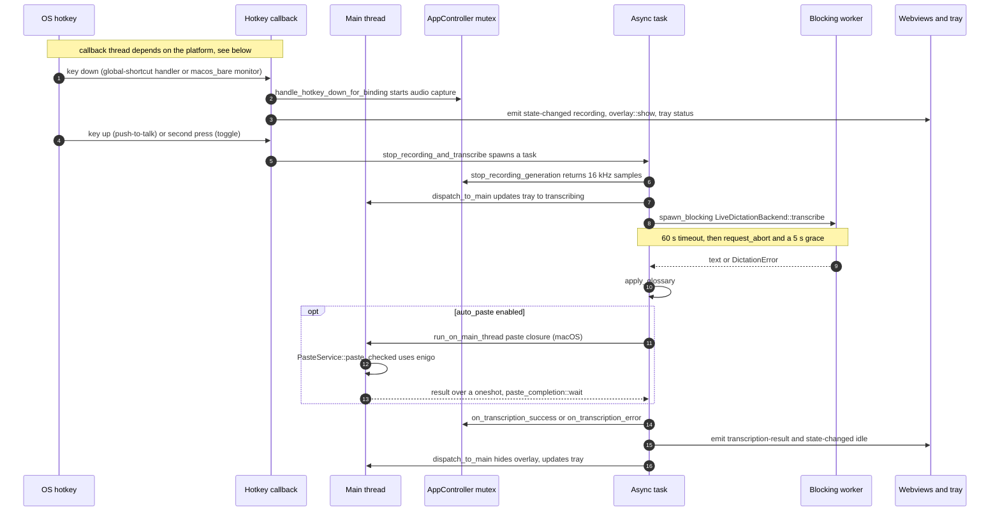
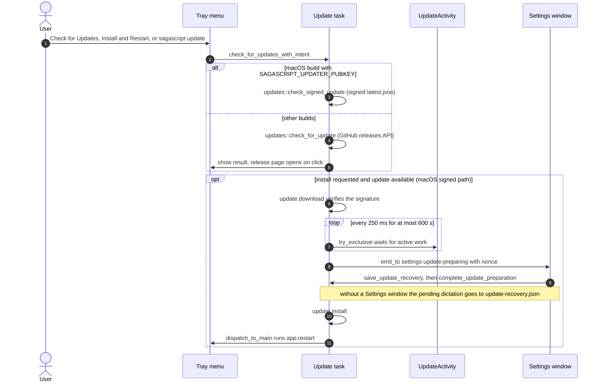
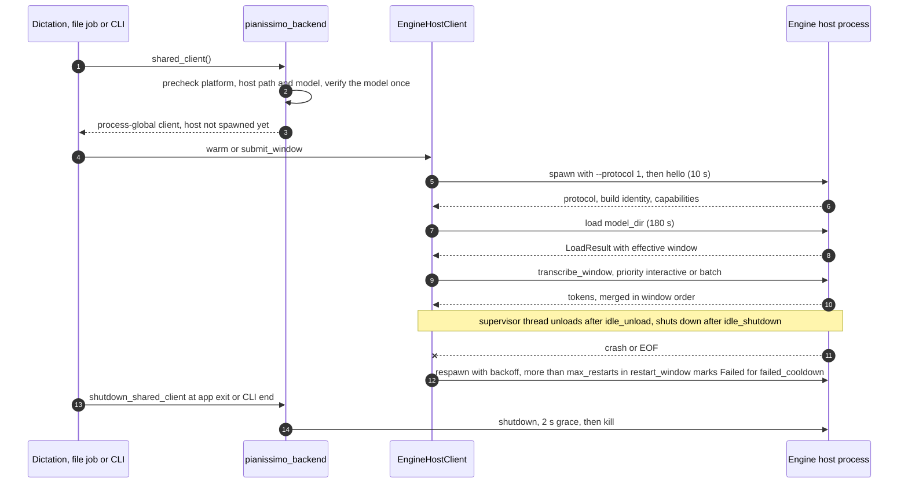

# Sagascript architecture

A map for agents and humans: what lives where, how the four main flows move through the
code, which threads and locks are involved, which feature flags exist, and where tests run.
It describes the code as it is; lines starting with **Planned:** link the issue that will
change a mechanism. Read [AGENTS.md](../AGENTS.md) first for the invariants and the
verification commands, [docs/recipes/](recipes/README.md) for step-by-step changes and
[docs/adr/](adr/README.md) for the reasons behind the rules.

## 1. Repository map

| Path | Responsibility |
|---|---|
| `src/` | Svelte 5 frontend (runes). `App.svelte` picks the view from the URL: `?overlay`, `?onboarding`, otherwise Settings. |
| `src/lib/api.ts`, `src/lib/meeting-reprocessing-api.ts` | The only `invoke` wrappers, plus hand-written TypeScript copies of Rust DTOs (`Settings`, `HotkeyProfile`, …). |
| `src/lib/ipc-contract.generated.ts`, `src/lib/events.ts` | The IPC surface: `CommandMap`, generated from the Rust command signatures, and `EventMap`, the payload of every event the frontend listens for ([contracts/README.md](../contracts/README.md)). |
| `src/lib/*.svelte` | `Settings.svelte` (Dictate / Transcribe / Settings tabs), `Onboarding.svelte`, `Overlay.svelte`, `FileTranscription.svelte`, `Meeting*.svelte`, `TranscriptionStages.svelte`. |
| `src/lib/*.ts`, `src/lib/*.js` | DOM-free logic (reducers, queues, update recovery), tested by Vitest next to the module and by the remaining `scripts/test-*.mjs`. |
| `src/lib/tauri-events.svelte.ts`, `models.svelte.ts`, `permissions.ts`, `platform.ts` | Shared by the windows. Tauri events are only listened to through `useTauriEvent`/`useDragDropEvent`/`subscribeTauriEvent` (they own the unlisten; ESLint forbids raw `listen()` in `src/`) and take their payload types from `EventMap` in `events.ts`; `models.svelte.ts` holds `PIANISSIMO_ID` and `downloadModelById`; `permissions.ts` the macOS Accessibility request and wait; `platform.ts` one `get_platform` lookup per window. |
| `src-tauri/src/` | App crate `sagascript`: CLI dispatch, Tauri shell, tray, hotkeys, paste, overlay, updater, Tauri commands. |
| `src-tauri/crates/sagascript-core/` | Library: audio decode/resample/capture, Whisper and Pianissimo transcription, engine-host client, model catalog (`models/`), settings store, model downloads, diarization (`diarization/`), shared meeting pipeline (`meeting/pipeline/`), and with the `diarization` feature the native reprocessing backend (`meeting/reprocess/native.rs`); meeting documents (`meeting/`), `fsutil` (publish a new file without ever replacing one, [ADR 0008](adr/0008-publishing-new-files.md)). |
| `src-tauri/crates/sagascript-cli/` | Library + headless `sagascript` binary: clap subcommands, CLI adapters, batch orchestration and output. Its `transcribe/` modules call the shared core meeting pipeline; with the `diarization` feature, `meeting_reprocessing_cli.rs` calls the native reprocessing backend. The app uses this crate for dispatch and launch integration. |
| `src-tauri/crates/sagascript-engine-protocol/` | Wire types for the engine-host JSON Lines protocol ([spec](engine-host-protocol.md)); used by the core client, the ORT host and the fake host. |
| `src-tauri/crates/sagascript-testsupport/` | Dev-only test helpers shared by core, CLI and app tests: `TempDir` (unique, removed on drop), `fake_settings` (a settings file alone in its own `TempDir`), `sha256_hex`, `isolated_cli_env` (spawned CLI without inherited credentials, with `SAGASCRIPT_SETTINGS_PATH`). Never linked into a shipped binary. |
| `src-tauri/engine-host/coreml/` | Swift package: Core ML host `sagascript-engine-host` (Pianissimo on macOS 14+ Apple silicon). |
| `src-tauri/engine-host/ort/` | Standalone Cargo workspace (own `Cargo.lock`): ONNX Runtime CPU host `sagascript-engine-host-ort`, shipped for Windows on ARM. |
| `src-tauri/engine-host/test-vectors/` | Vectors shared by both hosts' unit tests: `protocol/` (the golden JSONL transcripts and the scripted `fake-engine.json` that define the wire contract, also decoded by `sagascript-engine-protocol`; [spec](engine-host-protocol.md#golden-transcripts)) and `context-biasing.json`. |
| `src-tauri/tauri.conf.json`, `src-tauri/capabilities/` | App config (`frontendDist: ../dist`) and plugin permissions. |
| Meeting modules | Core `meeting/` (`mod.rs` the transcript document and its exports, `media.rs`, `review.rs`, `pipeline/` the shared file pipeline, `reprocess/{mod, matching, plan, proposal, io}.rs`, and with the `diarization` feature `reprocess/{native, orchestrate}.rs`: native execution, planning, and the staged publication of a reprocessing behind the `WorkBackend` seam; `control.rs` the cancellation and phases of a job, `source.rs` the hash that binds a document to its recording, `assemble.rs` the document from the segments of a diarized run); CLI `meeting.rs`, `meeting_proposal.rs` (the `meeting proposal` command), `meeting_reprocessing_cli.rs` (the `meeting reprocess` adapter), and `transcribe/` (CLI arguments, batch/output adapters and meeting-input validation); app `meeting_jobs.rs`, `meeting_media*.rs`, `meeting_review_commands.rs`, `meeting_reprocessing_commands.rs`, which call core entry points. Docs: `docs/meeting-*.md`. |
| Run context (#346) | Which profile, language and dictionary a file, recording or reprocessing run uses: core `run_context.rs` (`RunSelection` = profile and language, `RunContext` = those plus the dictionary; pure, no I/O; also `file_beam_size`, the beam default of a file run) and CLI `run_request.rs` (`RunRequest`: `--profile`, `--language`, `--prompt`, `--prompt-file` as typed; parses the language, reads the prompt file). `transcribe`, `record`, `meeting reprocess` and the app's file transcription (`commands/files.rs` `file_transcription_context`, which has no language override) all use it. The model is not resolved there: each caller chooses its own from the resolved language, which also fixes its order of errors (`tests/run_context_cli.rs`). |
| Settings operations (#373) | One implementation per settings operation that both `sagascript config` and the app's setters perform. Core `settings/ops.rs` holds them as `Settings` methods (`apply_language_selection`, `set_whisper_model`, `set_auto_select_model`, `set_pianissimo_dictation`, `apply_profiles_change`, `set_auto_paste`, `set_vad_enabled`; the machine-aware siblings of the `_gated` ones are in `machine.rs`). The CLI applies them from a key table (`config/keys.rs`, section 2.2), the app from `commands/settings.rs`; side effects stay with the surface. The CLI/app parity table is `core::test_support::settings_ops_table`. |
| Transcribe command (#343) | The shared file pipeline is core `meeting/pipeline/`: it owns the plan, source, inference, language detection, diarization steps, services, progress and result types. CLI `transcribe/` owns command arguments and input expansion (`args.rs`, `inputs.rs`), CLI resolution and adapters (`plan.rs`, `resolve.rs`, `vocab_correction.rs`, `plain.rs`), the Pianissimo batch, and `output.rs`/`BatchSink` for batch results, clipboard and output modes; `meeting.rs` validates the single-input meeting scope. Core's `Narrator` seam lets CLI `output::Out` provide captured stderr and a decode bar, while app meeting jobs use `StderrNarrator`. Tests: the sibling `transcribe_tests.rs`; `transcribe_file_tests.rs`, which drives a Whisper run in-process with a scripted `InferenceBackend` and, nested, the diarized path (`transcribe_diarized_tests.rs`: scripted `DiarizationAnalyzer`, cache hit and miss under both policies, failures and cancels that must keep the previous cache) and the Pianissimo batch (`transcribe_pianissimo_tests.rs`: scripted host and engine); and the whole command's observable contract (streams, exit status, error `code`, cache hits, cancellation, and a successful Pianissimo run against the fake engine host on macOS) in `tests/transcribe_contract.rs`. |
| `scripts/` | Build/release/CI helpers (`*.sh`, `*.mjs`, `*.ps1`), Node tests `test-*.mjs`, Playwright suites `qa-*.mjs`, browser IPC mock `fixtures/transcription-browser-mock.js`, Python tooling `dictation_eval/` and `diarization_sv/`, Core ML conversion `pianissimo-coreml/`. |
| `tests/` | Code-health contract tests (`tests/scripts/`) and fixtures (`tests/fixtures/code-health/`). |
| `contracts/` | The Rust–TypeScript transport contract: shared payload fixtures in `transport/` that Rust writes and Vitest parses ([README](../contracts/README.md), #347). |
| `tooling/code-health/` | Pinned `knip`/TypeScript used by `.github/workflows/code-health.yml`. |
| `site/` | Separate marketing site (React, vinext, Cloudflare `wrangler`); no workflow builds or lints it. |
| `test-audio/` | Small audio fixtures for smoke tests and benchmarks. |

App crate modules (`src-tauri/src/`):

| Module | Role |
|---|---|
| `main.rs` | Wiring only (#369): `main()` (CLI dispatch, logging), `build_app` (plugins, `.setup`, window events, the `generate_handler!` command table), `dispatch_to_main` and `SAFE_FALLBACK_HOTKEY`. |
| `launch/` | How the app starts and is started again: `GuiLaunchMode` and the second-instance checks (`mode.rs`), the `setup` hook in startup order (`startup.rs`), second-instance and run-event handlers (`lifecycle.rs`), the Settings window (`window.rs`), the legacy-settings migration and the permission-gated settings load (`settings.rs`). |
| `tray/` | Tray icon and menu: `create_tray` and the build identity (`mod.rs`), profile entries (`menu.rs`), status line, `tray_label` and `update_tray_status` (`status.rs`), macOS position and identity (`position.rs`). |
| `updater/` | The update flow: tray entries, menu state and the check (`mod.rs`), the update orchestrator behind the `MenuSink` / `CheckSource` / `UpdateProvider` / `Recovery` seams (`orchestrator.rs`), the macOS signed download and install (`signed.rs`), the manifest check (`updates.rs`), work/exclusivity accounting (`activity.rs`) and recovery drafts (`recovery.rs`). `main.rs` re-exports the last two as `crate::update_activity` and `crate::update_recovery`. |
| `dictation/` | Live dictation: hotkey press and release (`trigger.rs`), engine warm-up and load-state events (`engine.rs`), and the recording-to-paste pipeline `stop_recording_and_transcribe` (`pipeline.rs`). |
| `settings_watcher.rs` | Hot reload of settings and dictionaries edited outside the app. |
| `commands/` | Most `#[tauri::command]`s, one file per domain (`settings`, `hotkey`, `state`, `transcribe`, `transcribe_file`, `files`, `models`, `dictionary`, `update_recovery`, `permissions`, `system`), re-exported by `mod.rs` so `generate_handler!` names `commands::name`. `mod.rs` also holds `SharedController` / `SharedWhisper` / `lock_controller`; `persist.rs` holds `persist_and_sync`, the only way a command writes settings (file and controller copy together); `main_thread.rs` waits for the main thread without blocking a worker. |
| `app_controller.rs` | `AppController`: dictation state (`AppState`), audio capture, in-memory `Settings` copy, session logging. |
| `events.rs` | Event catalogue: every event's name, payload type, producer and consumer (`events::event::*`); emit with `EmitEvent::emit_event`, since a raw `tauri::Emitter::emit` is a clippy error. |
| `contract/` | Tests only: the shared fixture helper and the `CommandMap` generator (`command_map.rs`, parses `generate_handler!` and the command signatures with `syn`; a registered `commands::name` is looked up in `commands/mod.rs` and the files below it). |
| `hotkey/` | Shortcut registration, startup selection/cleanup (`startup.rs`), runtime replacement/rollback (`transition.rs`), `HotkeyHealth`, bare F-key monitor `macos_bare.rs`. |
| `paste/` | `PasteService` (clipboard + simulated paste: enigo on macOS/Windows, `xdotool` on Linux). `paste/completion.rs` (completion wait) is mounted from `main.rs` via `#[path]` as `crate::paste_completion`. |
| `platform/`, `overlay.rs`, `focus_diag.rs`, `logging/` | Per-OS helpers (`platform::mic_permission()`: the macOS microphone permission and its `unsafe` AVFoundation calls; `platform/macos.rs`), recording indicator window, focus diagnostics, app log file. |
| `plain_file_jobs.rs`, `meeting_*.rs` | File-transcription and meeting job slots, cancel, deadlines. |

**Dependency direction:** `sagascript-engine-protocol` ← `sagascript-core` ← `sagascript-cli`
← app. Core owns the shared meeting pipeline (`sagascript_core::meeting::pipeline`) and, with the
`diarization` feature, the native reprocessing backend (`sagascript_core::meeting::reprocess::native`). The CLI crate owns
clap parsing, subcommand dispatch, batch/output adapters and launch markers; the app imports it
only for dispatch and launch integration (`sagascript_cli::try_parse`, `run`,
`effective_log_filter` and `open::*`). App meeting jobs call core's pipeline and reprocessing
entry points directly. The reprocessing domain (plans, results, orchestration, proposal reading
and the diarization cache) is core's as well (`sagascript_core::meeting::reprocess::{orchestrate, io}`).

`sagascript-testsupport` is only a dev-dependency (of core, the CLI and the app) and depends
on none of them; fixtures made of core types (`meeting_transcript()`) live in
`sagascript_core::test_support` behind `cfg(test)` or core's `test-support` feature, which
the CLI and the app enable as a dev-dependency.

**Binaries:** the app crate and the CLI crate both build `sagascript`; a bare app invocation
starts the GUI, a subcommand runs the CLI and exits. The combined app/CLI binary intentionally
retains the CLI's clap dependency transitively for this dispatch path; separate binaries are a
later design decision. The headless CLI prints help and exits 2 without a subcommand.
`target/<profile>/sagascript` is whichever was built last. Core also
builds `sagascript-fake-engine-host` (`crates/sagascript-core/tests/support/fake_engine_host.rs`)
for tests.

**CLI output and exit:** both binaries call `sagascript_cli::run(cli) -> ExitCode` and return
it from `main`. `run_with(cli, &Out)` dispatches the subcommand and returns an `exit::Exit`
without exiting the process, so unit tests call it with `Out::capture()`. Every command writes
through `output::Out` (`outln!`/`errln!`, `Out::json`/`jsonl`; the crate denies
`println!`/`eprintln!`): a closed stdout pipe ends the run quietly with exit 0, and
`exit::conclude` maps the result to the exit status and, for a `--json`/`--jsonl` run that
failed before writing anything, writes one `{"status":"error","code","error"}` object on
stdout. `transcribe`'s three output modes live in one `BatchSink` (`transcribe/output.rs`). The statuses are listed in
[add-cli-subcommand.md](recipes/add-cli-subcommand.md#4-exit-codes).

**Build facts that bite:**

- Bare `cargo build/test/clippy` in `src-tauri/` covers only the app (`default-members = ["."]`);
  use `--workspace` or `-p`.
- `tauri::generate_context!()` needs `../dist`. Run `npm run build` before any cargo command
  that compiles the app crate (check, test, clippy), or it fails at compile time;
  `npm run verify` reports a missing `dist/` before running those checks.
- `swift test` needs `Sources/EngineHostCore/BuildInfo.swift`, which is gitignored and written
  by `scripts/build-engine-host.sh` (CI runs `scripts/stage-engine-host.sh` first;
  `npm run verify -- --only swift` runs it before `swift test`).
- `rust-toolchain.toml` pins the development compiler; `rust-version` in `src-tauri/Cargo.toml`
  is the minimum supported version (MSRV), checked by CI's `msrv-linux` job.
- Build identity comes from `src-tauri/build.rs` (`GIT_HASH`, `BUILD_DATE`, overridable with
  `SAGASCRIPT_GIT_HASH` / `SAGASCRIPT_BUILD_DATE`) and feeds the tray `BUILD_IDENTITY`, the
  `get_build_info` command and the engine-host handshake.

### 1.1 Layers inside `sagascript-core`

The layers below are *textual*: the imports of `models/`, `glossary.rs` and `settings/` point
downward, with one exception (below), and `crates/sagascript-core/tests/module_layering.rs`
checks that from the source text (every path the code names, `use` groups and renames
expanded) for the rules marked "tested". The rest is convention. The one exception is a
compatibility shim and closes no loop at run time.

| Layer | Modules | Rule |
|---|---|---|
| Leaves | `models/`, `glossary.rs` | `models/` is the model catalog: `WhisperModel` (21 models, ids via `id()` / `from_id()` / `FromStr`, `ALL`), its download URLs and SHA-256 in `sources.rs` (pinned revisions; `scripts/generate-third-party-notices.mjs` only asserts that six reviewed URL prefixes still appear in the model sources, `sources.rs` among them), `FileModel` (a Whisper model or Pianissimo) and `Language`, and `listing.rs`: the one `ModelInfo` per model (ids, names, download and installed size, languages, recommended, hidden in the app) behind `sagascript list-models` (`catalog`) and the app's pickers (`app_picker`), with what is downloaded and whether Pianissimo runs arriving as `ModelEnv` (#373). Imports neither `settings` nor `transcription` (tested) and returns no `whisper_rs` type: `transcription::whisper` (`whisper/words.rs`) maps a model to its DTW preset. `glossary.rs` (personal dictionary parser) imports nothing from the crate (tested). |
| Settings | `settings/` | Reads the catalog. Imports nothing from `transcription` (tested): what is downloaded and whether Pianissimo can run arrive as arguments, as `LineupEnv` / `MachineProbe` into the store and as the `pianissimo_supported` and readiness arguments of the `*_gated` methods of `Settings`. `ops.rs` is the settings operations of section 2.2; they take the Pianissimo gate and the Accessibility answer (`Accessibility`) the same way. |
| Runtime | `transcription/` (Whisper, Pianissimo, engine host, model downloads), `audio/`, `download.rs`, `meeting/`, `diarization/` | `transcription` reads `models` and the `Settings` type, and never loads the settings file: `pianissimo_backend::{engine_config, shared_client}` take the `Settings` their callers load with `machine::load` (only `settings/`, `machine.rs` and the `testing` seam name the store; tested). `transcription::model` and `pianissimo_model` answer whether a model is on disk; `pianissimo_backend::runtime_supported_on_this_os` answers whether Pianissimo runs. |
| Machine | `machine.rs` | The only place that feeds the runtime's answers to settings: `ThisMachine` (a `MachineProbe` and the `ModelEnv` of the model lists: `catalog`, `app_picker`, `model_info`), `load` / `update` / `try_update`, and the `Settings` methods without a `_gated` suffix (`dictation_model_for_profile`, `effective_file_model_for`, `warm_model_plan`, `apply_language_selection`, ...), each its `_gated` sibling plus this machine's probe. |

Old paths stay for one release (#372). The re-exports of `lib.rs` (the old top-level paths of
the modules that moved into `meeting/` and `diarization/`: `meeting_media`, `meeting_review`,
`meeting_reprocess`, `meeting_reprocess_plan`, `meeting_reprocess_proposal`, `speaker_hint`,
`diarization_report` and `diarization_{evaluation, qualification, reference, strata}`) and the
one in `settings/store.rs` (`settings::store::{load, update, try_update}`, which re-export
`machine`) are marked `// Shim (#372)` and `#[doc(hidden)]`; the CLI and the app import the
new paths, and a test (`nothing_in_the_workspace_uses_a_compatibility_path`) keeps it so. Each
is deleted after the next release. Two other families of old paths are still imported by the
CLI and the app and wait for their own change: `settings::{WhisperModel, FileModel, Language}`
(re-exports of `models`) and `transcription::{glossary, Glossary, ...}` (re-exports of
`glossary`), with `pianissimo_backend::UNSUPPORTED_MESSAGE`.

**The subsystems.**

- `meeting/`: `mod.rs` is the validated transcript document and its exports
  (`MeetingTranscript`); `media.rs` the audio attached to a meeting; `review.rs` the replayable
  corrections (`MeetingReview`); `reprocess/` the migration of a review onto a new
  transcript (`mod.rs` the preview, `matching.rs` segment and speaker matching, `plan.rs` what
  work a reprocessing needs, `proposal.rs` the saved proposal, `io.rs` the bounded reading and the
  no-replace writing of those documents, `orchestrate.rs` the execution of a plan: planning from
  the files, the staged publication, and the `WorkBackend` seam that a test replaces) (#374).
  `control.rs`, `source.rs` and `assemble.rs` are what a meeting run is made of: the
  cancellation flag and phases a job reports (`MeetingControl`, `MeetingPhase`), the stable hash
  of the recording, and the meeting document from the segments of a diarized run. Everything is
  compiled in every build except `orchestrate.rs`, which clusters through `diarization::engine`
  and so needs the `diarization` feature.
- `diarization/`: compiled in every build, except `engine/`. `mod.rs` holds the types
  (`DiarizeConfig`, `DiarizationAnalysis`, the segment types), the constants and the
  validation of a cached analysis; `speaker_hint.rs` the speaker-count hint, which the meeting
  document records; `model.rs` the model registry; `merge.rs` the join of speakers and
  transcript segments; `cache.rs` the reusable cache of a diarized run (#374: what `--diarize-cache`
  and selective reprocessing read and write; its types are the cache file's format); `report/` the evidence types (`mod.rs`) and the projection of a cached
  analysis onto them (`projection.rs`, `DiarizationAnalysis::report`); `eval/` the offline scoring
  against a reference, which only the CLI's `diarization` commands use (`rttm.rs` parses the RTTM and
  UEM files they read). `engine/` is what needs
  an optional dependency of the `diarization` feature (ONNX Runtime and ndarray in
  `segmentation.rs` and `embedding.rs`, rustfft in `fbank.rs`, kodama in `clustering.rs`) and
  the pipeline functions `analyze`, `diarize` and `cluster` that run them. Only `engine/` may name `ort`, `kodama`, `ndarray` or `rustfft` (tested), so the rest builds without the feature; `diarization::
  {analyze, cluster, clustering, embedding, ...}` re-export it when the feature is on.
  `eval/` is not behind a feature of its own: the CLI's lean build uses it (a feature for it is
  an open decision on #372).

**The top level of `src/`.** A subsystem is a directory; the files beside `lib.rs` are the
cross-cutting modules that belong to no one subsystem, and each has a row here.
`crates/sagascript-core/tests/top_level_modules.rs` compares this table, the files of `src/`,
the `mod` lines and the re-exports of `lib.rs`, so a new top-level file fails it until it gets a
row here and a line in the test: a deliberate decision (#372, owner decision of 2026-10-17).
`foo_tests.rs` files (test modules pulled in with `#[path]`, #363) do not count. A new subsystem
gets a directory of its own.

| Top-level module | Why it sits at the top level |
|---|---|
| `lib` | The crate root: the list of modules and, for one release, the old paths of moved modules. |
| `error` | `DictationError`, the one error type with stable codes ([ADR 0006](adr/0006-typed-errors.md)) that every subsystem returns. |
| `download` | The hash-verified streaming download behind every model downloader (Whisper, VAD, Pianissimo, diarization); `models/` imports only its `DownloadIntegrity`. |
| `fsutil` | Publishing a new file without ever replacing one ([ADR 0008](adr/0008-publishing-new-files.md)), used by the downloads and by every export the CLI and the app write. |
| `glossary` | The personal dictionary parser, a leaf that `settings`, `transcription` and the CLI read and that imports nothing from the crate (tested). |
| `hash` | SHA-256 as 64 lowercase hex digits, in memory (`sha256_hex`) or in pieces (`StreamingSha256`): one spelling for the source hashes, revisions, context hashes, staging names and download integrity that `meeting`, `diarization`, `download`, `fsutil` and the CLI write (#373). |
| `machine` | The one place that feeds this machine's answers to `settings` (the Machine layer above). |
| `path_scrub` | Removes absolute paths from error text before it reaches a log or the UI ([ADR 0006](adr/0006-typed-errors.md)), for `error` and the engine-host client. |
| `run_context` | Which profile, language and dictionary a file, recording or reprocessing run uses (#346), shared by the CLI commands and the app. |
| `sync` | Poison-tolerant locking ([ADR 0005](adr/0005-mutex-poison-policy.md)), used by `audio`, `download`, `transcription`, the CLI and the app. |
| `test_support` | Fixtures made of core types for the tests of the crates above core, compiled only under `cfg(test)` or the `test-support` feature (#363). |
| `testing` | The test seams: the few functions that let a test reach what production code must not (the startup load of an explicit settings file, the engine-host test hook, one idle-supervision pass). `#[doc(hidden)]` and always compiled, because core's own integration tests build the library without the `test-support` feature; nothing else in core names it (tested). |

**The one edge that goes up.** The last re-export is a line in `settings/store.rs` that names
`machine`, which imports transcription: textually the only upward import in `settings/`
(tested; the test lists the three paths it allows). It used to close a loop at run time:
`transcription::pianissimo_backend::engine_config` and `shared_client` called
`settings::store::load()`, which is that shim, so transcription called `machine::load()`,
which calls transcription's probes. They now receive the `Settings` they use (`shared_client`
reads `engine_idle_unload_minutes` only): the CLI and the app call `machine::load()` where the
read used to happen, and `LiveDictationBackend::new` and `warm_in_background`, which attach to
the engine later, take `machine::load` as a function and call it at that point, so no settings
file is read earlier than it was. Deleting the line, after the next release, is then the only
step left.

Public items that no code outside core names are `pub(crate)` (#372): an item the CLI or the app
needs is `pub`, one only core's own tests need is reached through `testing`. **Planned:**
[#372](https://github.com/Magnus-Gille/sagascript/issues/372) deletes the old paths above after
the next release.

## 2. Data flows

### 2.1 Dictation: hotkey → record → transcribe → paste



- Code: `handle_hotkey_event` and `handle_hotkey_release` in `src-tauri/src/dictation/trigger.rs`,
  `stop_recording_and_transcribe` and `restore_target_before_paste` in
  `src-tauri/src/dictation/pipeline.rs`; capture in `AppController`
  (`app_controller.rs`) over `sagascript_core::audio::AudioCaptureService`; engine choice in
  `crates/sagascript-core/src/transcription/live_dictation.rs` (Whisper via
  `transcription/whisper/` (still importable as `transcription::whisper_backend`), Pianissimo via
  `pianissimo_backend.rs` and the engine host, 2.4).
- `dictation/inference_wait.rs` owns only the asynchronous wait/abort/grace policy used by the
  live pipeline; model selection and inference remain one blocking transaction, and the caller
  retains timing, error, and logging behavior. This is the first small seam for #344; broader
  orchestration, generation, and whole-cycle boundaries remain in the existing pipeline.
- Callback thread: `tauri-plugin-global-shortcut` calls `handle_hotkey_event` inline from
  `global-hotkey`. On macOS that is the main thread (Carbon handler; the `macos_bare` NSEvent
  monitors too); on Windows key-down arrives on the main thread and key-up on a spawned
  `GetAsyncKeyState` polling thread; on Linux (X11) both arrive on the library's event thread,
  so the direct `overlay::show`, `select_profile_menu` and `update_tray_status` calls there
  break [ADR 0003](adr/0003-main-thread-native-apis.md) (known violation).
- Main-thread hops: the handler must not block (the 300 ms `MIN_RECORDING_MS` top-up is a
  `tokio::time::sleep` inside the task); tray and overlay updates from the task go through
  `dispatch_to_main`; on macOS `restore_target_before_paste` waits on the blocking pool and
  sends each AppKit call to the main thread with a 500 ms timeout, then the paste closure runs
  via `run_on_main_thread`. On Windows and Linux the paste closure runs on `spawn_blocking`.
- The Dictate tab's test recording (`commands::stop_and_transcribe`) repeats the
  timeout/abort transaction with its own `TRANSCRIPTION_TIMEOUT_SECS` / `ABORT_GRACE_SECS`.
  **Planned:** [#344](https://github.com/Magnus-Gille/sagascript/issues/344) makes the
  lifecycle testable outside Tauri.

### 2.2 Settings layers: disk ↔ store ↔ AppController ↔ watcher ↔ frontend

```mermaid
sequenceDiagram
    autonumber
    participant UI as Settings.svelte
    participant Cmd as Tauri setter command
    participant Store as settings store
    participant Disk as settings file
    participant Ctrl as AppController
    participant CLI as sagascript config
    participant W as Settings watcher thread
    UI->>Cmd: api.ts wrapper invokes set_x
    Cmd->>Store: persist_and_sync (one writer at a time) calls store::try_update
    Store->>Disk: lock json.lock, load and migrate, mutate, atomic save_to
    Store-->>Cmd: persisted Settings
    Cmd->>Ctrl: lock, the same change (or the written fields) on the controller's copy, demoted for this host; only the hotkey change replaces the whole copy
    Cmd-->>UI: Ok, then applySetting calls get_settings
    CLI->>Store: config set uses store::try_update
    Store->>Disk: same lock and atomic write
    Disk-->>W: file event (polled every 1 s on macOS)
    W->>Store: load_settings_with_permission_gate
    W->>W: re-register hotkeys if bindings changed
    W->>Ctrl: update_settings replaces the whole copy
    W->>UI: emit state-changed settings_reloaded
    UI->>Cmd: get_settings
```

| Layer | Where | Notes |
|---|---|---|
| Disk | `${XDG_CONFIG_HOME:-~/.config}/sagascript/sagascript-settings.json`, `glossary.txt`, `glossaries/*.txt` | See [configuration.md](configuration.md). `SAGASCRIPT_SETTINGS_PATH` selects an exact file and disables legacy migration (tests, isolated CLI runs). |
| Model | `Settings` in `crates/sagascript-core/src/settings/manager.rs` | `#[serde(default)]` on the struct: missing keys take `Default` values. The model types it names (`WhisperModel`, `FileModel`, `Language`) live in `models/` (section 1.1). |
| Store | `crates/sagascript-core/src/settings/store.rs` | `load_with`, `load_from`, `save`, `update_with`, `try_update_with` take the machine state as a `MachineProbe`; `machine::{load, update, try_update}` are them with this machine's probes (`store::{load, update, try_update}` re-export those for one release); cross-process `fs2` lock on `<file>.json.lock`; read-merge-write keeps unknown keys; atomic rename. |
| AppController | `app_controller.rs` | In-memory copy: `settings()`, `update_settings()` (`settings_mut()` in tests only). Dictation reads it at use time. It can differ from the file on purpose: the watcher keeps the registered shortcuts after a failed reload, and a host that cannot run Pianissimo demotes a selection of it in this copy only. |
| Watcher | `start_settings_watcher` in `settings_watcher.rs` | `PollWatcher` on macOS, `RecommendedWatcher` elsewhere; filter `configuration_event_may_affect`; waits while a dictation records (`acquire_hotkey_configuration`). Fires for the app's own writes too (harmless reload). |
| Frontend | `getSettings()` / setters in `src/lib/api.ts`; `settingsTransactionController.ts`, `modelCatalogController.ts`, `applySetting()` and the `settings_reloaded` listener in `Settings.svelte` | Re-reads after a write. A rejected setter saved nothing; a saved change whose re-read fails is reported as saved, never repeated and never rolled back: the window shows a Reload settings notice, disables the controls that save a setting and sends no further change until a read succeeds. Reads are settled in the order they were issued, so a late answer, success or failure, cannot replace or hide a newer one ([#341](https://github.com/Magnus-Gille/sagascript/issues/341)). File and profile model catalog requests publish only the latest complete result and are invalidated on unmount. Clearing a blocking dictionary and retrying its language change remains a separate compare-and-swap recovery flow. |

**Adding a frontend setting.** `Settings.svelte` owns the runes, visible notices,
control values and settings-read ordering. `settingsTransactionController.ts` owns
the write/read-back outcome: `saved: false` means no confirmed write; `saved: true`
with `confirmed: false` means the write completed but its read-back is uncertain.
Never retry the write just because that read-back failed. Add the typed API setter,
then use `applyScalarSetting` for a value that does not affect model selection, or
`applySetting` when profile models need refreshing. For example, the existing beam
size handler calls `await applyScalarSetting(() => setBeamSize(value))` and restores
the native select's previous value only when that call reports an unsaved change.
Use `saveSetting` directly when the caller needs the typed result or an `afterSave`
callback (for example, ending hotkey capture); that callback runs before read-back.
Add a rendered control test for rejection and for a successful write whose read-back
fails, using the typed mock IPC helpers in `src/test/settings.ts`.

`modelCatalogController.ts` owns request generation, cancellation and disposal;
the component's injected `load`, `publish` and `reject` callbacks own query composition
and UI state. File and profile catalogs use separate controller instances. Refresh
the existing instance instead of issuing an independent query: only the latest
complete answer may publish, and cancelling an older effect cannot cancel a newer
manual refresh. Dispose both instances when the component unmounts. The explicit
dictionary-clear/language-retry recovery transaction remains separate because it
coordinates two writes with compare-and-swap and its own recovery state.

Rules: write through `store::update`/`try_update` (never `save()` a possibly stale clone);
release the file lock before taking the controller lock; the watcher replays only hotkey
registration, Pianissimo warm/unload and the profiles menu, so side effects that live in a
setter (for example `overlay::on_show_overlay_changed`, the VAD model download in
`set_vad_enabled`) do not run for CLI edits. A value that does not read resets only its field,
with a warning, and a save over such a file first preserves its bytes as `.bak`. Migrations are
the ordered steps in `settings/migrations.rs`, recorded as `schema_version` plus the legacy
markers, and the copy from legacy locations ([ADR 0007](adr/0007-settings-file-evolution.md)).

**One implementation per operation ([#373](https://github.com/Magnus-Gille/sagascript/issues/373)
part 1).** `sagascript config set` and the app's setters are two entry points to the same user
intentions, so they call the same `Settings` operation (`settings/ops.rs`) and persist the same
state. The CLI's keys are one `Key { name, help, get, set, reset, warning }` each in
`crates/sagascript-cli/src/config/keys.rs`; `VALID_KEYS`, `config list`, the key lists and the value
table of `config list|get|set --help` and the `[possible values]` of the key argument are generated
from that table. A language is parsed by `Language::from_str` and a model by `WhisperModel::from_id`
on every surface (`config set language english` and `transcribe --language english` take the same
spellings; each surface keeps its own error text). Each decision where the two used to differ:

| Operation | Decision |
|---|---|
| `language` (`config set\|reset language`, `set_language`) | One operation: the default profile takes the language (a model of its own that the language cannot use goes back to Auto, with a notice), and the legacy `whisper_model` becomes the recommended model of the language with `auto_select_model` on. The app always did this; the CLI now does too. Reason: releases before the profile models read those fields (ADR 0007, rule 3), nothing that reads settings now consults them while a profile has a model (`config get whisper_model` and `auto_select_model` read the profile), and the CLI had no reason of its own. `config reset language` is the same operation with the default language. |
| `whisper_model`, `auto_select_model`, `pianissimo_dictation` (the default profile's model under its legacy names) | One operation each (`set_whisper_model`, `set_auto_select_model`, `set_pianissimo_dictation`); the legacy field moves with the profile model, as the CLI always did and the app did not. In the app this holds for the three IPC commands of those names only, and the GUI never calls them: its default-profile model pick goes through `set_profile_model`, which, like `config profiles update --model`, leaves the legacy fields as they were (part 2). Besides the rollback reason, the app's `set_auto_select_model(false)` pins the model `whisper_model` names, which the app's own `set_whisper_model` used to leave stale. A profile other than the default has no legacy field, so `set_profile_model` and `apply_profiles_change` do not touch them. |
| `auto_paste` | One operation, `set_auto_paste(requested, Accessibility)`. **Kept difference:** with the permission missing the app stores `false` and refuses; the CLI stores the request and warns. The permission belongs to the installed app's bundle identity, so a CLI process would probe the wrong program (and Linux and Windows have no such permission); the app applies it when it loads the settings (`load_settings_with_permission_gate`). The parity table marks this as the one case where the surfaces differ (`Case::differs_in`). |
| `vad_enabled` | One operation (`set_vad_enabled`), the stored value only. The app also fetches the Silero model when it turns the setting on (a side effect, so it stays there); the CLI fetches it on first use (`transcribe --vad`), and the settings watcher does not replay the download for CLI edits. |
| `hotkey` | The default profile is the one called `default`, else the first (`HotkeyProfile::default_index`), as the app's `set_hotkey` and `config reset hotkey` always chose it. `config set hotkey` used to write `hotkey` alone when no profile was called `default`, which no binding reads. Registering the shortcut with the OS stays in the app. |
| profile list and profile model (`config profiles create\|update\|remove`, `set_hotkey_profiles`, `set_profile_model`) | One operation, `apply_profiles_change(profiles, model)`. The CLI applies the list and a model given in the same command in one step and refuses all of it if the model does not fit; the app sends the list and the model as two commands. The parity table therefore holds only edits whose model fits. |
| `file_transcription_model`, `show_overlay`, `beam_size`, `temperature_fallback`, `engine_prewarm`, `engine_idle_unload_minutes`, `hotkey_mode` | A field (or `replace_hotkey_mode`) on both sides; no operation of their own. The parity table pins that neither surface adds anything. |
| a profile's dictionary (`glossary add`, `glossary suggest --apply`, `config set initial_prompt`; `set_profile_glossary`, `set_initial_prompt`, the training review) | The rules are one implementation, `settings/glossary_ops.rs` (#373 part 2): the profile has to exist (`Settings::dictation_profile`), a profile that detects its language (`Auto`) keeps hints but no aliases (`ensure_alias_profile`, `check_dictionary_source`), a term holds none of `\n \r , = \|` (`glossary::contains_delimiter`), and a reviewed suggestion is applied the same way (`apply_glossary_candidates`). Each surface words its own refusal (`DictionaryRefusal`), so its codes and texts did not change: "Glossary learning requires...", "Deterministic dictionary training requires...", "Auto-detect profiles support dictionary hints...". Stays in the surface: the app's compare-and-set against what the editor read, the CLI's listing and clearing of a dictionary whose profile was removed. **Kept difference:** `config set initial_prompt` merges into the default profile's dictionary (`merge_default_dictionary`), never erases an alias and does not apply the `Auto` rule; the app's `set_initial_prompt` replaces the dictionary and refuses aliases for `Auto`. Named in the parity table (`differs_in`) and in `config set --help`. |
| `config reset KEY` | The setter with the default value, on both surfaces, for the keys that are one (`language`, `hotkey_mode`, `show_overlay`, `auto_paste`, `vad_enabled`, `beam_size`, `temperature_fallback`, `engine_prewarm`, `engine_idle_unload_minutes`, `file_transcription_model`, `hotkey`); the app has no reset, so its side of a row is the setter. Not a row: `whisper_model`, `auto_select_model` and `pianissimo_dictation`, whose reset puts the profile's model back to Auto and moves one legacy field, which no setter does (part 2 of the legacy triple, below). **Not decided:** `config reset hotkey` on a profile with explicit push-to-talk or toggle bindings leaves them, and so the shortcut, where it was; the setter moves them. The row names it. |
| a settings file with steps pending (an older release's file) | Both surfaces migrate it when they write (`store::try_update_with`) and end where the operation on the migrated settings ends: rows start from a file with no `schema_version` and no profile models, a file at schema 3, and a newer release's file. The Swedish lineup step needs machine state, so the rows' files record it and what is pending is the same on every machine. |

Side effects stay in each surface and arrive as arguments (`Accessibility`, `pianissimo_supported`):
registering shortcuts with the OS, the VAD download, the Accessibility probe, the profiles menu and
the overlay. How the app's controller follows the file (`persist_and_sync`, `try_persist_and_mirror`
or, for the hotkey change only, `try_persist_and_replace`, above) is each setter's own; none but the
hotkey change adopts shortcuts the OS never registered, and every write demotes an unsupported
Pianissimo selection in the controller's copy as `store::load` does ([#458](https://github.com/Magnus-Gille/sagascript/issues/458)).

The parity table (`core::test_support::settings_ops_table`) is the check: each row is an operation
from a starting `Settings`, and `expected` computes with core alone what a surface must have
persisted (and nothing at all for an operation core refuses). The CLI runs every row through the real
`sagascript config` (`crates/sagascript-cli/tests/settings_parity.rs`), the app through its real
setters on Tauri's mock runtime in a child process on a fake settings file
(`commands/persist_parity_tests.rs`); both compare against the table (96 rows, 16 of them refusals,
8 starting from a file of an older release), so they are equal through core
and the app needs nothing from the CLI crate. A new operation that both surfaces perform gets a
`Settings` method, a row, and a call from each surface (docs/recipes/add-setting.md).

### 2.3 Updater phases



- Code: `check_for_updates_with_intent` in `updater/mod.rs`; the state machine behind the
  `MenuSink` / `CheckSource` / `UpdateProvider` / `Recovery` seams in `updater/orchestrator.rs`;
  `SignedCheck`, `SignedUpdate`, `DraftRecovery`, `install_signed_update` and
  `prepare_update_recovery` in `updater/signed.rs`; `updater/updates.rs`; `UpdateActivity` /
  `UpdatePreparation` in `updater/activity.rs`; `updater/recovery.rs`. Checks are never implicit
  (test `normal_gui_launches_never_check_for_updates_implicitly` in `launch/mode_tests.rs`).
  `sagascript update` (macOS) opens the app with `GUI_UPDATE_ARG` (`--install-update`), handled by
  `second_instance_requests_update` / `should_install_update_at_launch` in `launch/mode.rs`.
- A failure in any phase resets the menu to "Try Again…"; failures during preparation or
  install also emit `update-aborted` to Settings. The `updater-smoke-test` feature points the
  manifest at a loopback URL (section 4). [#376](https://github.com/Magnus-Gille/sagascript/issues/376)
  landed the orchestration behind those traits; the issue stays open for the remaining scope.

### 2.4 Engine-host process lifecycle



- Code: `crates/sagascript-core/src/transcription/engine_host/` (`process.rs` transport,
  `client.rs` handshake/lifecycle/restart budget, `pipeline.rs` long-audio windows) and
  `pianissimo_backend.rs` (`resolve_host`, `runtime_supported_on_this_os`, `config_for_host`,
  `shared_client`, `warm_in_background`, `shutdown_shared_client`). The client API is
  blocking; each host has a stdout reader and a stderr drain thread, and a client gets a
  supervisor thread only when an idle policy is set.
- Settings: `engine_idle_unload_minutes` → `idle_policy` (unload after N minutes, exit after
  2N, 0 = never); `engine_prewarm` (`off`, `on_app_start`, `on_key_down`). Hosts are
  resolved from the bundle (`Resources/EngineHost/sagascript-engine-host`,
  `engine-host\sagascript-engine-host-ort.exe`); `SAGASCRIPT_ENGINE_HOST` only in development
  builds (`dev-overrides`).
- Recovery ([#366](https://github.com/Magnus-Gille/sagascript/issues/366)): `Failed` lasts
  `failed_cooldown` (60 s), then one fresh start (half-open); a window that times out returns at
  once, and a detached `engine-host-wedge-watch` thread kills the host if it sends no terminal
  response within `wedge_grace` (30 s) after `cancel`; stdin writes are bounded
  (`Timeouts::write`); the restart backoff is slept unlocked and is cancel-aware.
  `EngineHostClient::reset()` clears `Failed` at once but has no production caller: settings that
  change the engine (host, model, compute units, idle policy) already replace the shared client
  (`shared_client`), model deletion shuts it down, and the CLI `engine doctor` uses its own client.
- PCM temp dirs hold a locked `owner.lock`; `pipeline::sweep_stale_pcm_dirs` (app startup and
  shared-client creation, background, once per process; `engine doctor` on demand) removes the
  dirs of dead owners, and dirs whose owner cannot be proven dead (pre-#366, or on a file system
  that cannot lock) once untouched for 24 h.
- **Planned:** [#367](https://github.com/Magnus-Gille/sagascript/issues/367) (machine-checked
  protocol).

## 3. Threads and locks

| Thread | What runs there |
|---|---|
| Main (UI) thread | Tauri setup, tray/window/overlay APIs, global-shortcut callbacks on macOS (and key-down on Windows), `macos_bare` callbacks, `run_on_main_thread` closures (macOS paste, AppKit focus calls), sync (non-`async`) Tauri commands. |
| Tokio runtime | `async` Tauri commands, tasks from `tauri::async_runtime::spawn` (dictation stop pipeline, update flow). |
| Blocking pool | `spawn_blocking`: inference, paste on Windows/Linux, focus-restore wait, recovery file I/O, and the file work of model downloads (`download::run_blocking`: directory preparation, hashing existing artifacts, fsync, rename and directory sync on install, Pianissimo staging and promotion). |
| Dedicated threads | Settings watcher, startup model warm-up, engine-host reader/stderr/stdin-writer/supervisor/wedge-watch threads and the PCM temp dir sweep, audio capture worker and cpal callback, `global-hotkey` event thread (Linux) and key-up polling thread (Windows). |
| CLI | `sagascript_cli::run` builds its own Tokio runtime; inference commands run on a worker thread (16 MiB stack on Windows, `run_inference_command`). |

| Lock | Where | Notes |
|---|---|---|
| `SharedController = Mutex<AppController>` | `commands/mod.rs`, managed in `launch/startup.rs` (`manage_app_state`) | Taken from commands, the hotkey handler, the watcher, the updater and meeting jobs, always via `lock_controller`. Audio start/stop and log writes happen under it. Never hold it across `.await` or inference; `SharedWhisper` lives outside it for that reason. |
| `<settings>.json.lock` | `with_settings_lock` in `settings/store.rs` | Exclusive file lock shared by app and CLI processes, held for read-merge-write only. |
| `HotkeyHealth { state, transition }` | `hotkey/health.rs` | `transition` serializes OS (un)registration between commands and the watcher; kept out of the controller on purpose (see its doc comment). |
| `UpdateActivity`, `UpdatePreparation` | `updater/activity.rs` | Work leases and the exclusive update permit. |
| Tray state (`SharedUpdateMenuState`, `SharedStatusItem`, `SharedProfileMenuState`) | `updater/mod.rs`, `tray/mod.rs` | Short critical sections. |
| Job slots (`MeetingJobs`, `SharedMeetingAudio`, `PlainFileJobs` fields) | `meeting_jobs.rs`, `meeting_media.rs`, `plain_file_jobs.rs` | One active job each. |
| `LoggingService` (`log_file`, `dictation_session_id`) | `logging/service.rs` | Taken inside controller methods. |
| `WhisperBackend` (`load_lock`, `state`, `loaded_runtime`, `cached_runtime`) | `transcription/whisper/` (struct, lock order and poison policy in `mod.rs`, locks and abort protocol in `runtime.rs`) | `load_lock` and `state` are taken with a bounded wait (`lock_load_bounded`, `lock_state_slot_bounded`, `WARM_STATE_GRACE`), returning `ModelBusy` instead of blocking. `loaded_runtime` holds the active model identity and its native context as one value (`Option<Loaded>`), so one cannot exist without the other. The runtime swaps take `state`, `loaded_runtime`, then `cached_runtime` (`publish_runtime`, `activate_cached_slots`); `with_state_slot` takes only `state`; building a warm state (the `create_state` closure of `with_warm_state_grace`, and the secondary states of a parallel run) takes `loaded_runtime` just long enough to clone out the context handle (`active_context`), inside the state lock. |
| Engine host (`lifecycle`, `state`, `boost`; process `routing`, `stdin`, `child`) | `engine_host/client.rs`, `process.rs` | `lifecycle` serializes start/load/unload/shutdown; it is released while a restart backoff is slept. `stdin` only guards the writer thread's queue, never a write. |
| Pianissimo `shared_slot` and load-state statics | `pianissimo_backend.rs` | Process-global client. |
| Others | `AudioCaptureService` buffers (`audio/capture.rs`), `GLOBAL_DICTATION` (`logging/service.rs`), the download `verification_cache` and `download.http_clients` client cache (`download.rs`), `LiveDictationBackend.active_job`, `PianissimoBackend.active`, `HostProcess` `stderr_tail`/`reader`, the CLI `Canceller` (`cancel.rs`) | Leaf locks. The capture buffers are taken under `SharedController` by start/stop and without it by the capture worker and cpal callback. |

Observed acquisition order (outer → inner). Nothing enforces it; keep new code consistent:

Shortcut replacement order and rollback outcomes live in `hotkey/transition.rs` behind the
`Registrar` seam. `NativeRegistrar` delegates to the existing Tauri registration functions;
the command and settings watcher retain their own locks, health messages, settings handling,
and events. Startup uses `hotkey/startup.rs`: `prepare` validates the whole saved
profile configuration and selects its shortcuts or the safe fallback; `apply`
registers that set and cleans up the entire attempted set if registration fails.
Its result distinguishes registered, inactive after successful cleanup, and unknown
after failed cleanup. The launch caller releases the controller lock before
registration and retains diagnostic logging, health recording and event emission.
Startup runs synchronously before the settings watcher starts; it does not acquire
the runtime transition guard. The native registrar and its thread placement are
unchanged. Startup tests inject the same `Registrar` seam as the transition tests;
they exercise production selection and cleanup without Tauri or real OS shortcuts.

1. `HotkeyHealth.transition` is held for a whole hotkey transaction (`apply_hotkey_change`,
   settings watcher). Inside it the controller lock and the settings file lock are each taken
   and released in turn, never nested. The configuration lease (`acquire_hotkey_configuration`)
   is a flag, not a lock: `apply_hotkey_change` takes `transition` then the lease, the watcher
   the lease then `transition`. No deadlock (the lease is try-acquire), but a GUI hotkey change
   that races a watcher reload fails with "Finish or cancel the active dictation…" while idle.
2. Setters take the settings file lock first, release it, then take the controller lock.
3. `MeetingJobs` slot → `SharedController` (`begin_meeting_file`).
4. `SharedController` → `UpdateActivity` state (work leases dropped in controller methods)
   and → `LoggingService` locks.
   - (4b) `SharedController` → `HotkeyHealth.state`: `handle_hotkey_event` reads
     `health.operational_hotkey()` under the controller guard; no reverse order exists.
5. `PlainFileJobs.active` → `pending_cancels`.
6. Engine host `lifecycle` → `state`.
7. Whisper `load_lock` → `state` → `loaded_runtime` → `cached_runtime` (comment above the lock
   names in `transcription/whisper/mod.rs`). Both outer locks are try-locks with a grace period,
   so an inversion surfaces as `ModelBusy`, not as a deadlock.

**Poison policy ([ADR 0005](adr/0005-mutex-poison-policy.md)):** `[profile.release]` deliberately
does not set `panic = "abort"`, so a panic while a lock is held poisons it. Locks recover instead
of propagating: `sagascript_core::sync::lock_or_recover` (and `commands::lock_controller` for
`SharedController`) take the data, clear the poison flag and log `error!` with the lock name and
the last panic message (`install_panic_recorder`). Where a panic can leave state stale, recovery
restores a safe state first (`lock_or_recover_with`): the engine-host client forgets `loaded` so
the next request re-validates the host, and the whisper warm state is discarded. The whisper
`load_lock` deliberately still fails closed with its restart message; Whisper dictation holds it
across inference, so a panic mid-inference leaves that backend unavailable until restart. Every
`SharedController` lock, including those in `meeting_jobs.rs`,
`meeting_reprocessing_commands.rs` and the pre-warm `try_lock`, goes through `lock_controller`
(or recovers `TryLockError::Poisoned`). `Drop` impls always use the tolerant helpers. The
settings watcher runs each event under `catch_unwind`; its health is
`HotkeyStatus.settings_watcher`. The meeting-job slot and the meeting audio attachment
(`meeting_media.rs`) are separate mutexes that still fail closed with an error message.

## 4. Feature flags

| Crate | Feature | Default | Gates |
|---|---|---|---|
| app `sagascript` | `custom-protocol` | on | `tauri/custom-protocol` (serve the bundled frontend). |
| app | `diarization` | on | Forwards to core and CLI; without it the meeting import commands return "This build has no speaker diarization support." |
| app | `updater-smoke-test` | off | `SIGNED_UPDATE_MANIFEST_URL` → `http://127.0.0.1:34827/latest.json`; enabled only by `.github/workflows/test-build.yml`. |
| app, core, CLI | `dev-overrides` | off | Release builds honor `SAGASCRIPT_ENGINE_HOST` / `SAGASCRIPT_PIANISSIMO_MODEL_DIR` (`transcription/dev_overrides.rs`; debug builds always do). |
| core | `record` | off | `audio::capture` / `AudioCaptureService` (cpal; ALSA on Linux). The app always enables it. |
| core | `diarization` | off | `ort`, `rustfft`, `kodama`, `ndarray`; `meeting/reprocess/orchestrate.rs` (it clusters through the engine); `diarization/engine/` (and the re-exports of its old paths from `diarization`); the `diarize_eval` example. |
| CLI | `record` | on | The `record` subcommand. |
| CLI | `diarization` | on | `--diarize`, `meeting_reprocessing*` (the `meeting reprocess` command and the native backend), `speaker_args`. |
| ORT host | `dev-overrides` | off | Release builds honor `ORT_DYLIB_PATH`. |

Feature unification: `cargo test --workspace` builds core with `record` and `diarization`
(enabled by the app and CLI). CI therefore also runs core and CLI per package to keep the
no-feature builds honest, and asserts that `cargo tree -p sagascript-cli --no-default-features`
contains no cpal/ALSA.

DTW word timestamps (`transcription/whisper/words.rs`, `ContextProfile::TokenAlignment`) have no
feature (#371). DTW is a whisper.cpp context option and whisper.cpp is linked into every build;
`words.rs` uses only `whisper-rs` and core types, none of the `diarization` feature's dependencies.
So the lean CLI and a core built without features load a token-alignment context and run the word
tests; the `diarization` feature gates the ONNX speaker pipeline that asks for it, not the timestamps.
Do not put a `cfg(feature = "diarization")` on code in `transcription/whisper/` unless it names `ort`,
`ndarray`, `rustfft` or `kodama`.

## 5. Where tests live and how CI runs them

Shared fixtures: `sagascript_testsupport` (`TempDir`, `fake_settings`, `sha256_hex`, `isolated_cli_env`) and
`sagascript_core::test_support::meeting_transcript()`; use them instead of hand-written
`std::env::temp_dir()` paths, cleanup guards or env-scrub loops.

| Layer | Location | Local command | CI |
|---|---|---|---|
| Rust unit, app | sibling `foo_tests.rs` files, declared last in `foo.rs` as `#[cfg(test)] #[path = "foo_tests.rs"] mod tests;` (`commands/settings_tests.rs` and the other `commands/*_tests.rs`, `launch/mode_tests.rs`, `tray/status_tests.rs`, `meeting_jobs_tests.rs`, `paste/windows_clipboard_tests.rs`); inline `#[cfg(test)]` modules in smaller files | `cargo test` (app only), `cargo test --workspace` (everything) | every OS lane (`cargo test --workspace`) |
| Rust unit, core/CLI/protocol | inline, or sibling `foo_tests.rs` as in the app: core `download_tests.rs`, `settings/manager_tests.rs`, `settings/store_tests.rs`, `transcription/whisper/*_tests.rs` (one per module, declared with `#[path]`); CLI `transcribe_tests.rs`, `transcribe_file_tests.rs` (with the nested `transcribe_diarized_tests.rs` and `transcribe_pianissimo_tests.rs`), `meeting_reprocessing_tests.rs`; `sagascript-engine-protocol/src/tests.rs` | `cargo test -p <crate>`; release-only guard: `cargo test --release -p sagascript-core --lib dev_overrides` | `cargo test --workspace` and the per-crate feature-subset gates on every OS; the release guard in test-linux |
| Rust integration | `sagascript-core/tests/*.rs` (engine host against the fake host, chunk-merge golden, Pianissimo adapter); `sagascript-cli/tests/*.rs` (spawn `CARGO_BIN_EXE_sagascript`) | `cargo test -p sagascript-core`, `-p sagascript-cli` | macOS, Linux, Windows |
| ORT host | `src-tauri/engine-host/ort/src/**` | `cargo test` and `cargo clippy --all-targets -- -D warnings` in `engine-host/ort/` | test-linux (fmt, test, clippy); test-windows (test, clippy) |
| Engine-host protocol | golden transcripts `src-tauri/engine-host/test-vectors/protocol/*.jsonl` with the scripted `fake-engine.json` ([contract](engine-host-protocol.md#golden-transcripts)); replayed by `sagascript-engine-protocol/src/vector_tests.rs`, `engine-host/ort/src/server/golden_tests.rs` and `ProtocolServerTests.swift` | `cargo test -p sagascript-engine-protocol`; `cargo test --locked` in `engine-host/ort/`; `swift test` | `cargo test --workspace` in every OS lane (protocol crate); test-linux, test-windows (ORT host); test-macos (Swift) |
| CLI/app parity (#373) | `core::test_support::settings_ops_table` (the rows and what each must persist) with its own consistency tests; the CLI side `sagascript-cli/tests/settings_parity.rs` (the real `sagascript config` on a fake settings file per row), the app side `commands/persist_parity_tests.rs` (the real setters, child process, fake settings file) | `cargo test -p sagascript-cli --test settings_parity`; `cargo test -p sagascript parity` | every OS lane (`cargo test --workspace`) |
| MSRV | whole workspace, lean CLI, ORT host | `RUSTUP_TOOLCHAIN=1.88 cargo check --workspace --locked` (see CONTRIBUTING.md) | msrv-linux |
| Swift | `src-tauri/engine-host/coreml/Tests/EngineHostCoreTests/` | `scripts/build-engine-host.sh`, then `swift test` (`npm run verify -- --only swift`) | test-macos |
| Frontend unit and component (Vitest) | `src/**/*.test.ts` next to the module or component, in happy-dom; typed IPC mock, setup and component backends in `src/test/` ([docs/testing/frontend.md](testing/frontend.md)) | `npm run test:unit` (`test:unit:coverage` for a report) | test-macos, test-windows; release-quality-gate, windows-package |
| Node | `test-*.mjs` and `test_*.mjs` anywhere under `scripts/` except `fixtures/` (`node:test`), each in one group of `scripts/node-test-groups.mjs`: `ui` (component source-text tests until #361 replaces them), `ci` (workflows, tooling), `release`, `codeHealth` | `npm run test:frontend` (all), `npm run test:ui` / `test:ci` / `test:release` | test-macos, test-windows |
| Code health | `scripts/test-code-health-*.mjs`, `tests/scripts/*.mjs` | `npm run test:code-health` | `code-health.yml`; the `scripts/` part also in test-macos, test-windows |
| Browser | `scripts/qa-*.mjs` with the mocked IPC in `scripts/fixtures/transcription-browser-mock.js` | `npx playwright install chromium && npm run test:browser` | test-macos |
| Python | `scripts/dictation_eval/test_*.py`, `scripts/diarization_sv/test_*.py` | `python -m unittest discover -s scripts/dictation_eval -p 'test_*.py'` | all OS (dictation_eval); Linux and macOS (diarization_sv) |
| Types | Svelte/TS, including the Vitest files | `npx svelte-check --tsconfig ./tsconfig.json` | test-macos |
| Transport contract | Rust: `transport_contract*` tests in `events_tests.rs`, `commands/settings_tests.rs`, `meeting_jobs_tests.rs` and `contract/` write or compare `contracts/transport/*.json` and `src/lib/ipc-contract.generated.ts`; TS: `src/test/transport.test.ts`, `src/lib/api.test.ts` ([contracts/README.md](../contracts/README.md)) | `cargo test contract` in `src-tauri/` (`SAGASCRIPT_BLESS_CONTRACTS=1` regenerates), `npm run test:unit`, svelte-check | with the app tests and the frontend suites |
| Formatting | Prettier over `src/`, `scripts/`, `tests/` (not `.svelte` yet; `.prettierignore`) | `npm run format:check` (`npm run format` fixes) | test-macos, test-windows |
| Lint | ESLint over `src/` (TypeScript, Svelte), `scripts/`, `tests/` (`eslint.config.js`, baseline in `eslint-suppressions.json`) | `npm run lint` | test-macos |
| CLI smoke | release binary in `ci.yml` build jobs, `scripts/ci/smoke-cli.mjs` (one script for every OS; `basic` tier without a model: help, `config`, `list-models`, `formats`, completions of every shell; `model` tier: download + transcribe, `--json`, `--jsonl`, a closed pipe and the error object through `scripts/verify-json-cli-streams.py`) | `node scripts/ci/smoke-cli.mjs basic --binary <path>` | build-macos, build-windows (Windows tolerates the `model` tier, #357) |
| Conformance | `scripts/engine-host-conformance.py <host> --no-model` against a real host process; with `--model-dir <dir>` the full run | model-free: `npm run verify -- --only engine-host-conformance` (macOS); full run by hand with a downloaded model | model-free subset: the staged Core ML host in test-macos and the signed host in `release-build-macos.yml`; full run (release gate, each time right after a Pianissimo smoke): `release-build-macos.yml` against the host in the installed signed app (prebuild and fallback paths), `scripts/verify-release-draft.sh` against the host in the downloaded draft (promote path in CI, fallback path by hand) and the manual `test-build.yml` ([spec](engine-host-protocol.md#conformance)) |

CI (`.github/workflows/ci.yml`) has a test lane per OS (test-macos, test-linux, test-windows), a native
build lane with the CLI smoke tests on macOS and Windows, an MSRV lane on Linux, and the `check-*`
aggregators that branch protection reads (`check-macos` and `check-windows` are required). The parts
every lane shares live once, outside the workflow (#358): `.github/actions/setup` (Python, the pinned
Rust toolchain, Node.js, the Rust cache, `npm ci`), `scripts/ci/cargo-gates.mjs` (the one list of cargo
commands, run by every lane with `--os`; the MSRV lane runs its `msrv` profile), `scripts/ci/smoke-cli.mjs`
and `scripts/ci/assert-lanes.mjs` (what an aggregator asserts about the lanes it needs). The same cargo
commands run on every OS except the gates marked `os:` in the list, each with its reason: formatting,
`cargo deny`, the core feature subsets (`diarization`, `record`), the lean-CLI build for the Python
suites, the ALSA tree check and the release-profile guard run on Linux only, the ORT host gates on
Linux and Windows. Everything else is `cargo clippy` and `cargo test` over the workspace, over core
and over the lean CLI (`--no-default-features`). Besides the cargo gates test-linux runs the clippy policy
counts (`scripts/clippy-policy.mjs`, which must not rise) and the offline diarization evaluation;
msrv-linux runs `cargo check --workspace --locked`, the lean CLI and the ORT host on the `rust-version`
toolchain (1.88), and check-linux requires it; test-macos runs `npm audit --audit-level=high`, the
frontend suites (Prettier, ESLint, Vitest, Node), Svelte types, the Swift tests and the engine-host
conformance subset; test-windows runs the same frontend suites except ESLint and the Windows build
identity gates. test-windows owns the Windows tests of every pull request:
`windows-package.yml` (on PRs touching `src/`, `src-tauri/`, `scripts/`, package files,
`.gitattributes` or the workflow itself) repeats `cargo test --workspace` and clippy only for
releases (`prebuild-release.yml`) and manual runs, on both architectures;
`release-quality-gate.yml` runs them for a release. A PR that only touches
`README.md`, `docs/release-readiness.md` or `docs/research/**/*.md` skips the native lanes
(`scripts/ci-docs-scope.mjs`). Locally, `npm run verify` runs the test and lint suites above
(`scripts/verify.mjs`, documented in [CONTRIBUTING.md](../CONTRIBUTING.md#running-tests));
`scripts/test-verify-ci-parity.mjs` keeps its check list in step with the commands the test lanes run,
gate list and setup action included. The `scripts/test-ci-*.mjs` tests read the workflows as parsed
YAML (`scripts/lib/ci-workflow.mjs`), not as text.
**Planned:** [#361](https://github.com/Magnus-Gille/sagascript/issues/361) phase B
replaces the remaining source-text tests in the `ui` group with component tests.

## 6. Known drift and planned changes

- Event and payload exceptions are named in the catalogue rather than removed
  ([#347](https://github.com/Magnus-Gille/sagascript/issues/347), [contracts/README.md](../contracts/README.md)):
  `state-changed` also carries `settings_reloaded`; `navigate_tab` is snake_case;
  `transcription-progress` and `transcription-phase` have no GUI listener; the
  `model-download-progress` `model` field is a Debug name for Whisper. Twenty registered
  commands have no frontend caller (`COMMANDS_WITHOUT_A_CALLER` in `src/lib/api.test.ts`);
  removing them is undecided.
- Every command returns `Result<T, CommandError>` (`{ code, message, retryable }`, ADR 0006)
  and the frontend matches on `code` only. Still strings, **planned** for part 2b of
  [#360](https://github.com/Magnus-Gille/sagascript/issues/360): the payload of the `error`
  event, the file-transcription view treating a backend `cancelled` as cancelled, the hotkey path
  showing a cancellation as an error, and the "Try again" / "Download the model again" buttons.
- Only some CLI subcommands offer `--json` (`list-models`, `config list`, `glossary list`,
  `formats` and `config profiles list` do not), `--progress-json` events share stderr with prose
  and `tracing`, and a second Ctrl-C still force-quits from the signal thread
  (`cancel.rs`). Follow-ups of [#364](https://github.com/Magnus-Gille/sagascript/issues/364).
- Whisper and Pianissimo are selected by hand (`LiveDictationBackend::new(whisper, pianissimo)`);
  there is no engine trait. **Planned:** [#378](https://github.com/Magnus-Gille/sagascript/issues/378).
- `main.rs` was split in [#369](https://github.com/Magnus-Gille/sagascript/issues/369) and
  `commands.rs` in [#370](https://github.com/Magnus-Gille/sagascript/issues/370); update this map
  when files move.
- Left over from [#373](https://github.com/Magnus-Gille/sagascript/issues/373) (parts 1 and 2 are
  section 2.2). Each of these changes what a surface persists or prints, so each is a decision of
  its own: the GUI's model pick keeping the legacy fields in step (`set_profile_model` leaves
  `whisper_model`, `auto_select_model` and `pianissimo_dictation` as they were; today only the three
  commands the GUI never calls, `config set` and a language change move them); the legacy triple
  consistent in itself (`pianissimo_dictation` false when `config set whisper_model` or a change to
  Auto chooses a Whisper model, and true only while Pianissimo is chosen: a downgrade case of ADR 0007,
  rule 3; `config reset` of the three keys belongs here, as it moves one legacy field only); the
  `whisper_model` list of `config set --help` generated from `WhisperModel::ALL` (it lists 11 of the 21
  models; generating it changes help text); `config set initial_prompt` merging where
  `set_initial_prompt` replaces, and accepting aliases for a profile that detects its language where
  the app refuses; `config reset hotkey` leaving explicit bindings; the model lists, which are one
  `models::catalog` / `app_picker` but keep two sizes for Pianissimo (`list-models` the size on disk,
  the picker the download, the same in MB today) and `list-models` has no `--json`, as the ticket
  assumed; `list-models` marks the models the app hides without regard to the platform (where
  Pianissimo runs the picker also leaves out KB-Whisper Medium, which the list does not mark);
  `Settings::set_legacy_language` and `warm_model_plan_gated` still spell the choice of the default
  profile out (`HotkeyProfile::default_index` is it everywhere else); `app_controller.rs` still turns a
  model into its id through serde; the summary in `config --help` (`lib.rs`) lists 6 of the 15 keys.
- Most `async` Tauri commands in `commands/` have no `.await` and call synchronous helpers
  that write the settings file (`persist_and_sync` → `store::update`, under the settings file
  lock) on a Tokio worker. Model downloads and Pianissimo installs already do their file work
  on the blocking pool ([#368](https://github.com/Magnus-Gille/sagascript/issues/368)). **Not
  done in #370:** the setters stay `async fn`s that write on the worker. They cannot become
  plain `fn`s (a sync command runs on the main thread, ADR 0003), and `spawn_blocking` needs an
  owned handle on the controller, which Tauri manages by reference, so moving the write off the
  worker is a separate change.
